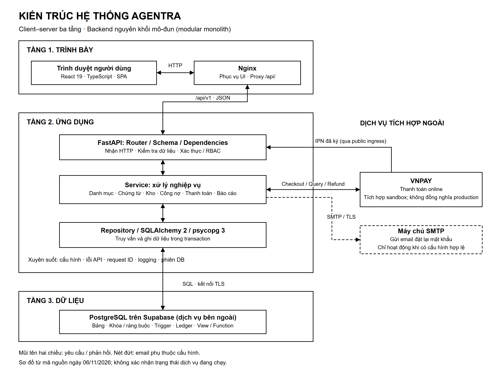

# Kiến trúc hệ thống Agentra

## 1. Mô hình kiến trúc

Agentra là hệ thống quản lý đại lý (Dealer Management System, DMS), được xây dựng theo mô hình **client–server kết hợp kiến trúc ba tầng (three-tier architecture)**. Ba tầng chính gồm tầng trình bày, tầng ứng dụng và tầng dữ liệu. Người dùng thao tác trên ứng dụng web; yêu cầu nghiệp vụ được gửi đến máy chủ ứng dụng qua HTTP API; dữ liệu được lưu trữ tập trung trong PostgreSQL.

Backend được tổ chức theo **kiến trúc nguyên khối mô-đun (modular monolith)**: các chức năng được chia thành những module nghiệp vụ nhưng cùng được tổng hợp và chạy trong một ứng dụng FastAPI. Các module dùng chung cơ sở dữ liệu và cơ chế giao dịch. Hệ thống không triển khai mỗi module thành một microservice độc lập.

Trong báo cáo, có thể kết luận: **“Hệ thống sử dụng mô hình client–server ba tầng; backend được tổ chức theo module và phân tách trách nhiệm tiếp nhận API, xử lý nghiệp vụ, truy cập dữ liệu.”** Cách diễn đạt này phù hợp hơn việc gọi toàn bộ hệ thống là MVC, bởi giao diện React tách khỏi backend và backend không tạo trang HTML theo mô hình MVC truyền thống.

## 2. Ba tầng của hệ thống

| Tầng | Thành phần chính | Trách nhiệm |
|---|---|---|
| 1. Trình bày | React 19, TypeScript, React Router; Nginx phục vụ tài nguyên web | Cung cấp giao diện, điều hướng, biểu mẫu, bảng dữ liệu và trạng thái xử lý; gửi yêu cầu API và hiển thị phản hồi. |
| 2. Ứng dụng | FastAPI, các router, schema, dependency, service và repository | Xác thực, kiểm tra quyền, kiểm tra dữ liệu, điều phối nghiệp vụ, quản lý giao dịch và tích hợp các dịch vụ ngoài. |
| 3. Dữ liệu | PostgreSQL được lưu trữ trên Supabase | Lưu dữ liệu nghiệp vụ, bảo đảm toàn vẹn bằng khóa/ràng buộc/trigger, duy trì sổ biến động và cung cấp dữ liệu tổng hợp. |

### 2.1. Tầng trình bày

Ứng dụng React chạy trong trình duyệt của người dùng. Các màn hình được nhóm theo chức năng trong `ui/src/features/`; cấu trúc điều hướng và bố cục chung đặt trong `ui/src/app/`. Thành phần giao tiếp API tại `ui/src/lib/api.ts` thực hiện gửi yêu cầu, đính kèm thông tin xác thực và xử lý phản hồi.

Trong cấu hình Docker, Nginx phục vụ các tệp HTML, CSS và JavaScript đã được Vite biên dịch. Đồng thời, Nginx chuyển tiếp các yêu cầu có đường dẫn `/api/` đến backend. **Nginx không thực thi React thay cho trình duyệt**; Nginx là thành phần phục vụ web và reverse proxy hỗ trợ tầng trình bày, không phải một tầng nghiệp vụ bổ sung.

Giao diện điều chỉnh menu và quyền truy cập màn hình theo người dùng. Tuy nhiên, việc ẩn nút hoặc chặn đường dẫn trên frontend chỉ hỗ trợ trải nghiệm sử dụng; quyết định cấp quyền cuối cùng vẫn thuộc backend.

### 2.2. Tầng ứng dụng

FastAPI cung cấp các API dưới tiền tố `/api/v1`. Mỗi module chịu trách nhiệm cho một nhóm nghiệp vụ như quản lý đại lý, hàng hóa, nhập hàng, xuất hàng, công nợ hoặc thanh toán. Các phần bên trong backend được chia theo trách nhiệm:

| Phần nội bộ | Vai trò | Vị trí điển hình |
|---|---|---|
| Tiếp nhận API | Nhận HTTP, kiểm tra cấu trúc dữ liệu, lấy thông tin người dùng và kiểm tra quyền; chuyển yêu cầu đến service. | `modules/<feature>/router.py`, `schemas.py`, `dependencies.py` |
| Xử lý nghiệp vụ | Kiểm tra điều kiện nghiệp vụ, điều phối nhiều thao tác, xác định ranh giới transaction và tạo kết quả. | `modules/<feature>/service.py` |
| Truy cập dữ liệu | Thực hiện truy vấn, khóa bản ghi, đọc/ghi dữ liệu bằng SQLAlchemy và psycopg. | `repository.py`, `models.py`, `app/db/` |

Router, Service và Repository là **các phần logic bên trong tầng ứng dụng**, không phải ba máy chủ và không phải ba tầng triển khai riêng. Việc phân tách cũng không tuyệt đối: một số service đang thực hiện trực tiếp câu lệnh SQLAlchemy. Vì vậy, sơ đồ thể hiện luồng tổ chức chủ đạo, không khẳng định mọi câu lệnh SQL đều bắt buộc đi qua repository.

Các module dùng chung hỗ trợ xử lý chứng từ, phân bổ tiền, tính số chính xác, kiểm tra phiên bản dữ liệu, chống xử lý lặp, phân trang và chuẩn hóa lỗi. Cấu hình, logging, request ID, quản lý phiên kết nối và bảo mật là các trách nhiệm xuyên suốt.

### 2.3. Tầng dữ liệu

Backend kết nối PostgreSQL trên Supabase bằng SQLAlchemy đồng bộ và trình điều khiển psycopg 3. Trình duyệt không kết nối trực tiếp tới PostgreSQL và không sử dụng Supabase Auth để đăng nhập ứng dụng.

Dữ liệu ứng dụng tập trung trong schema `dms`. Ngoài các bảng quan hệ, hệ thống sử dụng domain số chính xác, view, hàm và trigger để hỗ trợ nghiệp vụ và giữ tính nhất quán. Các sổ biến động kho, công nợ và dư có giữ lịch sử phát sinh; bảng số dư hiện tại hỗ trợ truy vấn nhanh. Việc bảo vệ dữ liệu không chỉ nằm ở Python mà còn được thực thi tại PostgreSQL.

Schema được quản lý bằng Alembic và các tệp SQL có phiên bản. Migration là tác vụ quản trị được thực hiện riêng, không tự chạy khi API khởi động. Phạm vi bảng, quan hệ và các giới hạn của DBML được trình bày trong [Mô tả cơ sở dữ liệu](04_Mo_ta_co_so_du_lieu.md).

## 3. Tổ chức triển khai

Docker Compose định nghĩa hai dịch vụ chạy thường trực: `frontend` (Nginx) và `backend` (FastAPI/Uvicorn). Dịch vụ `migrate` thuộc profile `tools` là tác vụ chạy một lần. PostgreSQL nằm trên Supabase, không phải một container database trong cấu hình Compose này.

| Thành phần triển khai | Cách tổ chức trong cấu hình hiện tại |
|---|---|
| Trình duyệt | Tải bundle React và gọi API qua địa chỉ web của ứng dụng. |
| Nginx | Cổng web mặc định `8080`; phục vụ SPA và chuyển tiếp `/api/` tới `backend:8000` trong mạng Docker. |
| FastAPI/Uvicorn | Chạy một worker; cổng API trực tiếp trên máy chủ mặc định là `127.0.0.1:8000`. |
| Supabase PostgreSQL | Dịch vụ bên ngoài, được backend truy cập qua kết nối PostgreSQL có cấu hình TLS. |
| Alembic | Chạy riêng khi cần nâng cấp schema, sử dụng cùng image và cấu hình backend. |

Trong môi trường phát triển, Vite có thể thay Nginx để phục vụ frontend và proxy API. Đây là phương thức chạy phát triển, không phải một tầng mới trong kiến trúc. Cấu hình Compose không tự cung cấp điểm kết thúc HTTPS công khai; khi công bố Internet, cần ingress/HTTPS phù hợp. Đường nhận IPN thanh toán phải truy cập được từ cổng thanh toán.

## 4. Tích hợp bên ngoài

**VNPAY:** hệ thống có mã tạo liên kết thanh toán, tiếp nhận IPN, xử lý Return, truy vấn trạng thái và yêu cầu hoàn tiền. Cấu hình native được giới hạn ở môi trường sandbox. Backend xác minh bằng chứng từ cổng thanh toán trước khi ghi nhận kết quả tài chính; việc trình duyệt quay về trang Return không tự chứng minh đã thu được tiền.

**SMTP:** dùng để gửi email đặt lại mật khẩu khi có cấu hình hợp lệ. Đây là tích hợp phụ thuộc cấu hình vận hành; không nên ghi trong báo cáo rằng email luôn hoạt động ở mọi môi trường.

**Trợ lý AI:** mã nguồn frontend hiện chỉ có trang thông báo chưa khả dụng, chưa có backend chatbot được mount. AI không được đưa vào sơ đồ như một dịch vụ đang hoạt động.

## 5. Sơ đồ kiến trúc

*Hình 1. Kiến trúc client–server ba tầng của hệ thống Agentra. Các phần Router, Service và Repository nằm bên trong cùng một backend.*

- [Hình vector SVG](So_do/Kien_truc_he_thong.svg): giữ độ nét khi phóng to hoặc in.
- [Hình PNG](So_do/Kien_truc_he_thong.png): dùng trực tiếp trong báo cáo.
- [Nguồn draw.io](So_do/Kien_truc_he_thong.drawio): mở bằng diagrams.net để chỉnh sửa các khối và đường nối.
- [Prompt tạo ảnh](Prompts/Kien_truc_he_thong.txt): phương án tạo hình minh họa tương đương.

Sơ đồ rút gọn các trao đổi với VNPAY thành kết nối logic. Thực tế, người dùng mở checkout trong trình duyệt; IPN là yêu cầu từ máy chủ VNPAY tới API qua điểm truy cập công khai, còn Return là chuyển hướng trình duyệt. Mũi tên IPN tới Router không biểu thị kết nối bỏ qua reverse proxy hoặc truy cập trực tiếp database.

## 6. Căn cứ và phạm vi xác nhận

Tài liệu phản ánh mã nguồn trong working tree được đối chiếu ngày **06/11/2026**, kể cả các thay đổi chưa commit. Không sử dụng những đoạn tài liệu cũ mô tả UI starter làm kết luận về frontend hiện tại. Việc có route/component không đồng nghĩa mọi luồng đã được nghiệm thu end-to-end.

| Nội dung | Nguồn đối chiếu |
|---|---|
| Dịch vụ, cổng, migration và worker | `compose.yaml` |
| Static hosting và reverse proxy | `ui/nginx.conf`, `ui/Dockerfile` |
| Frontend, routes và giao tiếp API | `ui/package.json`, `ui/src/app/App.tsx`, `ui/src/app/navigation.ts`, `ui/src/lib/api.ts` |
| Khởi tạo và tổng hợp backend | `backend/app/main.py`, `backend/app/api/router.py` |
| Truy cập DB và transaction | `backend/app/db/session.py`, `backend/app/core/transactions.py` |
| Phân lớp thực tế, bao gồm SQL trong service | `backend/app/modules/stock_receipts/service.py`, `backend/app/modules/inventory/repository.py` |
| Thanh toán và cấu hình | `backend/app/modules/online_payments/`, `backend/app/core/config.py` |
| AI chưa khả dụng | `ui/src/features/chatbot/ChatbotPage.tsx`, `backend/app/api/router.py` |

Các đường dẫn nguồn trong bảng tính từ gốc repository. Đợt soạn báo cáo này không khởi động lại dịch vụ, không kết nối database live và không xác nhận bản triển khai đang chạy đồng nhất với mã nguồn.
