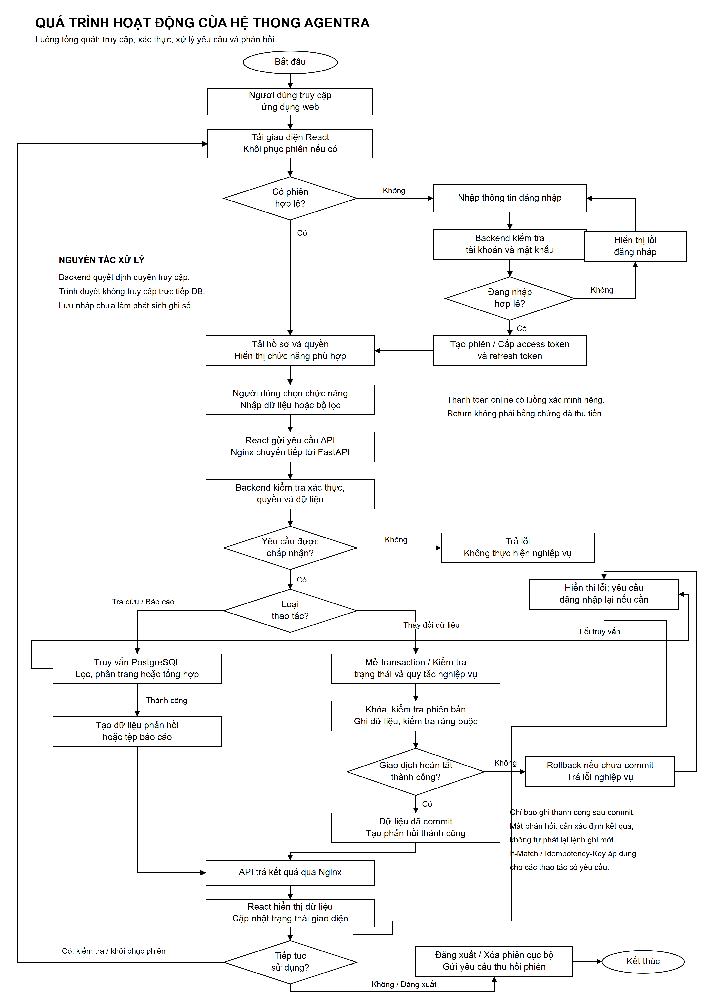

# Quá trình hoạt động của hệ thống

*Lưu đồ tổng quát, trắng đen, bố cục khổ A3 dọc. Hình được dựng bằng mã từ prompt để giữ chính xác nhãn tiếng Việt.*

[PNG độ phân giải cao](So_do/Qua_trinh_hoat_dong.png) | [SVG vector](So_do/Qua_trinh_hoat_dong.svg) | [Nguồn draw.io](So_do/Qua_trinh_hoat_dong.drawio) | [Prompt](Prompts/Qua_trinh_hoat_dong.txt)

Tái tạo hình bằng `node BC/So_do/export-workflow.mjs` từ gốc repository, sử dụng Playwright trong `ui/node_modules` và Microsoft Edge đã cài. Lần xuất hình này không chạy test/build/verify, không kiểm tra trực quan bằng ảnh. Sơ đồ rút gọn luồng; lỗi trong bước kiểm tra hoặc ghi dữ liệu của transaction đi đến nhánh thất bại, không phải luôn thực hiện mọi bước bất kể lỗi.

## 1. Nguyên lý chung

Agentra hoạt động theo cơ chế yêu cầu và phản hồi giữa trình duyệt với máy chủ. Người dùng thực hiện thao tác trên giao diện; frontend gửi yêu cầu tới API; backend kiểm tra quyền và điều kiện nghiệp vụ, truy cập dữ liệu khi cần, sau đó trả kết quả để giao diện cập nhật. Với thao tác thay đổi dữ liệu, backend chỉ thông báo thành công sau khi giao dịch cần thiết đã được xác nhận.

Luồng xử lý chủ đạo là: **Người dùng → React → Nginx → FastAPI → xử lý nghiệp vụ → PostgreSQL → phản hồi API → giao diện**. Trong quá trình này, backend có thể trao đổi với VNPAY hoặc SMTP tùy nghiệp vụ.

## 2. Truy cập và đăng nhập

1. Người dùng mở địa chỉ web. Nginx trả các tệp giao diện; trình duyệt khởi chạy React và xác định màn hình cần hiển thị.
2. Nếu chưa có phiên hợp lệ, người dùng nhập thông tin đăng nhập. Frontend gửi yêu cầu đến API xác thực.
3. Backend kiểm tra dữ liệu, trạng thái tài khoản và mật khẩu đã băm bằng Argon2id. Yêu cầu không hợp lệ bị từ chối, không tạo phiên đăng nhập thành công.
4. Khi xác thực thành công, backend phát access token dạng JWT và refresh token; cơ sở dữ liệu lưu thông tin phiên cùng digest của token cần quản lý, không lưu refresh token thô để xác minh.
5. Frontend giữ access token trong bộ nhớ và lưu thông tin refresh trong `sessionStorage` theo tab. Giao diện tải thông tin người dùng, quyền và hiển thị menu phù hợp.
6. Những yêu cầu được bảo vệ gửi kèm Bearer token. Backend kiểm tra chữ ký, thời hạn, phiên, phiên bản xác thực và quyền hiện tại trước khi cho phép thao tác.

Khi tải lại trang, frontend có thể dùng refresh token còn hợp lệ để khôi phục phiên rồi lấy thông tin `/auth/me`. Quá trình refresh xoay vòng token: token cũ bị thu hồi và token mới được phát trong cùng phiên, không tự kéo dài thời hạn tuyệt đối của phiên.

Khi đăng xuất, frontend xóa thông tin phiên, hủy các yêu cầu liên quan và làm sạch cache; backend thu hồi phiên tương ứng. Đổi hoặc đặt lại mật khẩu có cơ chế vô hiệu hóa token cũ. Với luồng quên mật khẩu, hệ thống gửi email chứa liên kết đặt lại chỉ khi cấu hình SMTP hợp lệ; thiếu cấu hình gửi mail được phản hồi là dịch vụ chưa khả dụng.

## 3. Tra cứu dữ liệu

1. Người dùng mở danh sách hoặc đặt bộ lọc, ví dụ danh sách đại lý, tồn kho hoặc công nợ.
2. Frontend tạo yêu cầu GET kèm tham số lọc, phân trang và token xác thực.
3. Nginx chuyển yêu cầu `/api/` tới FastAPI. Router kiểm tra cấu trúc tham số; dependency xác thực và kiểm tra quyền của người dùng.
4. Service điều phối việc đọc dữ liệu. Repository hoặc câu truy vấn thuộc service truy xuất PostgreSQL theo điều kiện đã được kiểm tra.
5. Backend trả dữ liệu đã chuẩn hóa. Những giá trị cần giữ độ chính xác, như tiền và số lượng, được truyền theo hợp đồng API thay vì tùy ý chuyển sang số thực trên giao diện.
6. Frontend kiểm tra phản hồi và hiển thị danh sách, chi tiết hoặc thông báo không có dữ liệu. Khi có lỗi, giao diện hiển thị trạng thái lỗi thay vì coi dữ liệu trống là thành công.

## 4. Tạo và ghi sổ chứng từ

Hệ thống tách **lập nháp** khỏi **ghi sổ**. Việc tạo phiếu nháp không đồng nghĩa tồn kho hoặc công nợ đã phát sinh. Tác động chính thức xuất hiện khi chứng từ đáp ứng điều kiện của nghiệp vụ và được ghi sổ.

Ví dụ đối với phiếu nhập hàng:

1. Người dùng có quyền tạo phiếu nhập, nhập ngày nghiệp vụ, chọn mặt hàng và khai báo số lượng, đơn giá.
2. Frontend kiểm tra dữ liệu đầu vào ở mức giao diện rồi gửi yêu cầu tạo nháp. Backend kiểm tra lại trước khi lưu chứng từ và phiên bản nháp.
3. Người dùng bổ sung hoặc chỉnh sửa dòng hàng. Những thao tác cần bảo vệ phiên bản gửi `If-Match` theo ETag nhận từ máy chủ để tránh ghi đè dữ liệu đã bị người khác thay đổi.
4. Khi người dùng chọn ghi sổ, frontend gửi yêu cầu tương ứng kèm `Idempotency-Key` để nhận diện cùng một ý định thao tác khi phải gửi lại.
5. Backend kiểm tra quyền ghi sổ, khóa những dữ liệu cần thiết và xác nhận phiếu vẫn là bản nháp hiện tại. Dòng hàng, số lượng, giá trị và giới hạn tồn kho được kiểm tra.
6. Trong cùng transaction, hệ thống cập nhật chứng từ và phiên bản sang trạng thái đã ghi sổ, tạo đợt ghi sổ và thêm bút toán kho. Các ràng buộc và trigger tại PostgreSQL tiếp tục bảo vệ tính nhất quán.
7. Nếu toàn bộ thao tác hợp lệ, transaction được commit. Backend trả kết quả mới để giao diện cập nhật chứng từ và thông tin liên quan.
8. Nếu có lỗi trước khi hoàn tất transaction, các thay đổi trong transaction được rollback; backend trả lỗi để người dùng xử lý nguyên nhân. Không thông báo thành công khi chỉ mới hoàn tất một phần thao tác.

Các nghiệp vụ xuất hàng, trả hàng, thu tiền và bù trừ sử dụng cùng nguyên tắc kiểm tra quyền, trạng thái và tính nguyên tử, nhưng tạo tác động khác nhau lên kho, phải thu hoặc dư có. Không phải mọi loại chứng từ đều tác động đồng thời đến cả ba loại số dư.

Khi sửa hoặc hủy chứng từ đã ghi sổ, hệ thống thực hiện quy trình correction/cancellation có kiểm soát, sử dụng phiên bản và bút toán điều chỉnh/đảo theo nghiệp vụ, thay vì tùy ý sửa hoặc xóa lịch sử sổ phát sinh.

## 5. Thanh toán online qua VNPAY

| Bước | Thành phần thực hiện | Nội dung |
|---|---|---|
| 1 | Người dùng và frontend | Yêu cầu tạo giao dịch thanh toán cho nghiệp vụ được hỗ trợ. |
| 2 | Backend | Kiểm tra quyền, điều kiện và số tiền; tạo thông tin giao dịch cùng URL checkout có chữ ký. |
| 3 | Trình duyệt và VNPAY | Người dùng mở trang checkout và thực hiện thanh toán trong môi trường sandbox được cấu hình. |
| 4 | VNPAY và API IPN | VNPAY gửi thông báo tới endpoint IPN công khai; backend xác minh chữ ký HMAC-SHA512 và bằng chứng giao dịch. |
| 5 | Backend và PostgreSQL | Kiểm tra mã tham chiếu, số tiền, trạng thái và việc đã xử lý; chỉ khi bằng chứng hợp lệ mới ghi nhận kết quả tài chính, tạo/ghi sổ phiếu thu tương ứng theo nghiệp vụ. |
| 6 | Trình duyệt và Return | Trình duyệt có thể được chuyển về endpoint Return để hiển thị thông tin. Return không tự ghi nhận đã thu tiền. |
| 7 | Frontend và backend | Giao diện lấy trạng thái do backend quản lý; nghiệp vụ đối soát có thể dùng truy vấn máy chủ để xác minh giao dịch còn chưa rõ kết quả. |

IPN và Return là hai luồng độc lập, có thể đến không cùng thứ tự; số thứ tự trong bảng dùng để giải thích vai trò, không áp đặt thứ tự nhận mạng. Callback gửi lặp không được làm phát sinh thu tiền trùng. Nếu chưa có bằng chứng kết quả cuối cùng, không chuyển trạng thái chờ thành thành công chỉ vì người dùng đã mở trang thanh toán hoặc quay lại ứng dụng.

Hoàn tiền online cũng có vòng đời riêng. Việc đã gửi yêu cầu hoàn hoặc nhận phản hồi đang xử lý không đồng nghĩa ngân hàng đã hoàn tiền. Báo cáo này mô tả mã tích hợp sandbox, không xác nhận thanh toán hoặc hoàn tiền production.

## 6. Dashboard và báo cáo

1. Người dùng chọn tháng hoặc bộ lọc báo cáo và yêu cầu xem dữ liệu.
2. Backend kiểm tra quyền xem báo cáo cùng quyền truy cập dữ liệu liên quan. Dashboard chỉ trả các phần phù hợp với quyền của người dùng.
3. Service đọc và tổng hợp dữ liệu theo kỳ. Dashboard sử dụng transaction chỉ đọc ở mức cô lập `REPEATABLE READ` để các phần trong cùng kết quả được đọc từ một snapshot nhất quán.
4. API trả dữ liệu cho giao diện hoặc xuất tài liệu theo định dạng được hỗ trợ. Các nhóm báo cáo hiện có gồm doanh số, công nợ, tồn kho, doanh số theo mặt hàng và dòng tiền/dư có.
5. Khi xuất XLSX/PDF, dữ liệu được lấy theo toàn bộ bộ lọc, không chỉ các dòng của trang đang hiển thị trên bảng.

## 7. Kiểm soát lỗi và tính nhất quán

| Tình huống | Nguyên tắc xử lý |
|---|---|
| Token không hợp lệ hoặc phiên bị thu hồi | Backend từ chối truy cập; giao diện chuyển về trạng thái xác thực phù hợp. |
| Không có quyền nghiệp vụ | Backend từ chối, kể cả khi người dùng tự gọi API ngoài giao diện. |
| Dữ liệu đầu vào sai | Trả lỗi kiểm tra dữ liệu; không tiếp tục như một thao tác hợp lệ. |
| Chứng từ đã bị thay đổi | Kiểm tra điều kiện phiên bản, không âm thầm ghi đè dữ liệu mới. |
| Gửi lặp lệnh quan trọng | Dùng idempotency và trạng thái command để kiểm soát việc thực thi lại. |
| Lỗi trong transaction | Rollback; một số xung đột serialization/deadlock có retry giới hạn ở backend. |
| Phản hồi mạng bị mất sau lệnh ghi | Không suy ra thao tác chắc chắn thất bại hoặc tự tạo ý định mới; cần kiểm tra kết quả và giữ đúng khóa thao tác khi gửi lại. |
| Access token hết hạn khi gọi API | Client tự refresh/retry cho GET theo chính sách hiện tại; không tự phát lại mutation như một yêu cầu đọc. |
| Dịch vụ email/cổng thanh toán chưa sẵn sàng | Hiển thị lỗi hoặc trạng thái chờ phù hợp, không tạo kết quả thành công giả. |

## 8. Nguồn đối chiếu

Đường dẫn tính từ gốc repository:

- `ui/src/features/authentication/session.ts`, `AuthContext.tsx`: quản lý phiên phía trình duyệt.
- `ui/src/lib/api.ts`: HTTP, header điều kiện, idempotency và chính sách refresh.
- `backend/app/modules/auth/service.py`, `dependencies.py`, `tokens.py`: xác thực và vòng đời token.
- `backend/app/modules/stock_receipts/router.py`, `service.py`: ví dụ tạo/ghi sổ phiếu nhập.
- `backend/app/core/transactions.py`: ranh giới giao dịch và retry.
- `backend/app/modules/online_payments/vnpay_router.py`, `vnpay.py`, `service.py`: IPN, Return và ghi nhận thanh toán.
- `backend/app/modules/dashboard/service.py`, `backend/app/modules/reports/service.py`: snapshot, quyền và tổng hợp báo cáo.

Các luồng trên được mô tả từ mã nguồn ngày 06/11/2026. Đợt lập tài liệu không chạy lại kiểm thử giao dịch, browser end-to-end hoặc kết nối cổng thanh toán thực tế.
