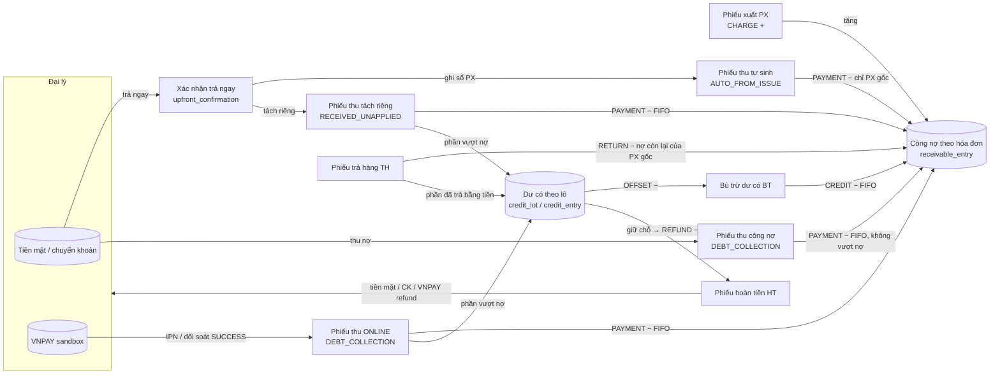
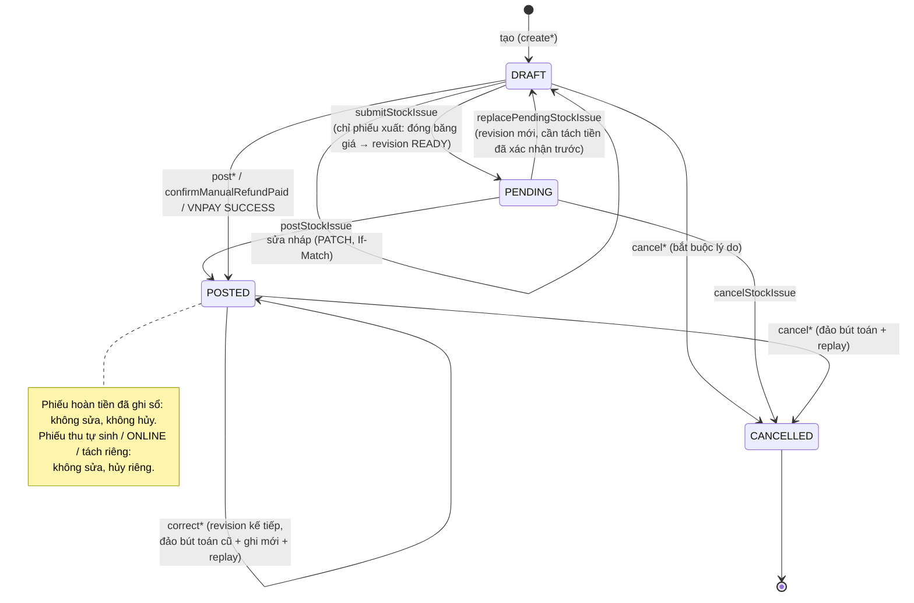

# Logic nghiệp vụ dòng tiền

Ngày đối chiếu mã nguồn: **13/11/2026** (nhánh `deploy-prod`, schema nguồn đến migration `0009`). Tài liệu mô tả **mã đang chạy** trong `backend/app/modules/*` và trigger/hàm SQL trong `backend/alembic/sql/0001..0009`. Khi kế hoạch trong `openwiki/` khác mã nguồn, tài liệu theo mã nguồn và ghi chú sai khác ở mục 17. Đây là đối chiếu tĩnh: lần lập tài liệu này không chạy test, không kết nối database.

Đường dẫn trích dẫn viết tắt:

| Viết tắt | Đường dẫn |
|---|---|
| `SQL` | `backend/alembic/sql/0001_initial.sql` |
| `M/…` | `backend/app/modules/…` |

## 1. Khái niệm và đơn vị tiền

| Khái niệm | Ý nghĩa trong hệ thống | Nơi lưu |
|---|---|---|
| **Công nợ** (phải thu) | Tiền đại lý còn nợ theo **từng phiếu xuất** (hóa đơn). Tổng công nợ = tổng số dư của mọi phiếu xuất. | Sổ `receivable_entry`; cache `agency_balance.currentDebt` |
| **Dư có** (credit) | Tiền thật đại lý đã trả **vượt** phần nợ, theo dõi theo **lô dư có** (`credit_lot`), mỗi lô nhớ phiếu thu gốc đã tạo ra tiền đó. Dư có là khoản phải trả lại cho đại lý, không phải công nợ âm. | Sổ `credit_entry`, `credit_lot`; cache `agency_balance.currentCredit` |
| **Dư có khả dụng** | Dư có trừ phần đang **giữ chỗ** (reservation) cho phiếu hoàn tiền. | View `credit_availability` (`SQL:1437-1443`) |
| **Hạn mức nợ** | `agency_type.maxDebt`; công nợ hiện tại của đại lý không được vượt hạn mức của loại đại lý. | `SQL:92-100` |
| **Tỷ lệ giá bán** | `business_rule.sellingPriceRate` (mặc định 1,02 = 102%). Đơn giá xuất = làm tròn(giá nhập hiện tại × tỷ lệ). | `SQL:75-81` |

Kiểu dữ liệu tiền và tỷ lệ được ràng buộc ngay tại PostgreSQL (`SQL:10-18`):

- `money_vnd`: số nguyên VND, |giá trị| < 10^18, **không có phần lẻ**. Domain kiểm tra `VALUE = trunc(VALUE)` trước khi làm tròn nên 1,5 VND bị từ chối thay vì bị làm tròn ngầm.
- `quantity_value`: tối đa 3 chữ số thập phân; đơn vị tính không cho phép lẻ thì số lượng phải nguyên (`SQL:727-731`).
- `price_rate`: 0 < tỷ lệ < 1000, tối đa 6 chữ số thập phân.

**Quy tắc làm tròn** (đều là làm tròn nửa lên, đến đơn vị đồng):

| Đại lượng | Công thức | Nguồn |
|---|---|---|
| Đơn giá xuất | `round(basePurchasePrice × sellingPriceRate, 0)`; kết quả phải là `PositiveMoney`, nếu không → `SELLING_PRICE_UNUSABLE` | `M/document_core/service.py:84-105`, `backend/app/common/prices.py:9-17`, kiểm tra lại ở `SQL:987-992` |
| Thành tiền dòng | `round(|quantity| × unitPrice, 0)` (cột sinh `lineAmount`) | `SQL:244`, `backend/app/common/values.py:63-75` |
| Tổng phiếu | Tổng các `lineAmount` đã làm tròn (không làm tròn lại tổng) | `M/document_core/service.py:40-54`, `SQL:976-980` |
| Thành tiền dòng trả hàng | **Làm tròn lũy kế**: `round(tổng SL đã trả đến nay × đơn giá gốc) − tổng tiền các lần trả trước` | `M/sales_returns/rounding.py:8-34`, `SQL:1015-1025` |
| Tỷ lệ doanh số (BM6.1) | Phép chia số nguyên đã nhân tỷ lệ, làm tròn một lần đến 4 chữ số thập phân | `M/reports/queries.py:13-18` |
| Số tiền VNPAY | `amount × 100`, phải ≤ 999.999.999.999 (tức ≤ 9.999.999.999 VND); chiều về phải chia hết cho 100 | `M/online_payments/vnpay.py:37-58` |

Tổng hợp lớn trong Python dùng `localcontext(prec ≥ 64/80)` để không mất chính xác khi cộng chuỗi thời gian dài (`M/settlement_core/replay.py:63-66`).

## 2. Mô hình sổ cái

Mọi tác động tiền là **bút toán chỉ ghi thêm** (append-only). `receivable_entry`, `credit_entry`, `inventory_entry`, `posting_batch`, `credit_lot`, `payment_event`, `audit_log` bị trigger `deny_change` chặn UPDATE/DELETE (`SQL:1362-1364`). Muốn đổi kết quả thì ghi **bút toán đảo** (`reversesEntryId`) đúng bằng âm của bút toán gốc, cùng ngày/thứ tự hiệu lực (`SQL:800-817`), rồi ghi bút toán mới.

| Sổ | Loại (`kind`) | Dấu | Chứng từ nguồn được phép (`SQL:835-859`) |
|---|---|---|---|
| `receivable_entry` | `CHARGE` | + | Phiếu xuất (chính nó) |
| | `PAYMENT` | − | Phiếu thu |
| | `RETURN` | − | Phiếu trả hàng (vào phiếu xuất gốc) |
| | `CREDIT` | − | Phiếu bù trừ dư có |
| `credit_entry` | `CREATED` | + | Phiếu thu (thu dư) hoặc phiếu trả hàng (trả vượt phần nợ) |
| | `OFFSET` | − | Phiếu bù trừ dư có |
| | `REFUND` | − | Phiếu hoàn tiền (lô phải thuộc đúng phiếu thu gốc) |

Mỗi lần ghi sổ một phiên bản tạo một `posting_batch` loại `POST` (duy nhất cho mỗi revision, `SQL:318`), `REVERSE` (đảo khi sửa/hủy) hoặc `REALLOCATE` (phân bổ lại khi replay). Ngày/thứ tự hiệu lực của bút toán phải trùng với `businessDate` của revision và `businessOrder` của chứng từ; phiếu thu tự sinh dùng `businessOrder` của phiếu xuất gốc (`SQL:819-825`).

`businessOrder` lấy từ sequence khi chứng từ được ghi sổ lần đầu và **không đổi** khi sửa (`SQL:625-627, 640-644`). Thứ tự thời gian nghiệp vụ là cặp `(businessDate, businessOrder)`.

Cache `agency_balance`/`inventory_balance` không được ghi trực tiếp (`protect_balance`, `SQL:514-520`, sửa ở `0006`); chúng được tính lại bởi constraint trigger hoãn (`DEFERRABLE INITIALLY DEFERRED`) cuối giao dịch (`SQL:1388-1403`).

### 2.1 Bất biến do database bảo đảm

| Bất biến | Hàm/trigger |
|---|---|
| Số dư từng phiếu xuất **không bao giờ âm** tại mọi thời điểm lịch sử và hiện tại | `assert_agency` `SQL:885-902` |
| Số dư từng lô dư có không âm (lịch sử và hiện tại) | `SQL:892-902` |
| Số dư lô ≥ tổng giữ chỗ hoàn tiền đang hoạt động | `SQL:903-907` |
| Công nợ hiện tại ≤ hạn mức của loại đại lý | `SQL:910-911` |
| Phiếu thu/bù trừ phải phân bổ **FIFO** vào hóa đơn cũ nhất tính tới thời điểm hiệu lực | `SQL:1101-1123` |
| Bút toán của mọi phiên bản cũ phải được đảo hết; bút toán còn hiệu lực khớp đúng phiên bản hiện hành | `SQL:938-950, 1072-1084` |
| Phiếu thu công nợ thủ công không được tạo dư có | `SQL:1085-1088` |
| Phiếu thu tự sinh phải trả đúng phiếu xuất của nó, không tạo dư có | `SQL:842-844, 1089-1091` |
| Trả hàng: giảm nợ còn lại của hóa đơn trước, phần vượt mới thành dư có | `SQL:1092-1100` |
| Phiếu xuất có trả ngay phải có xác nhận đã dùng (`CONSUMED`) và phiếu thu tự sinh khớp số tiền, ngày | `SQL:1026-1037` |
| Phiếu thu `ONLINE` phải gắn với đúng một giao dịch trực tuyến `SUCCESS` cùng số tiền | `SQL:1044-1050, 1136-1150` |
| Tổng hoàn đã chi + đang giữ chỗ ≤ số tiền phiếu thu gốc | `SQL:1059-1065` |
| Hoàn tiền `ONLINE` đã ghi sổ phải có lần thử provider `SUCCESS` cùng số tiền | `SQL:1066-1070`, `assert_refund` `SQL:1170-1203` |
| Phiếu hoàn tiền đã ghi sổ không được hủy | `SQL:629-631` |
| Tiền trả ngay của phiếu xuất không đổi qua các lần sửa | `SQL:696-700` |

Khi bút toán mới có ngày/thứ tự **sớm hơn** bút toán đã có, hoặc là bút toán đảo, trigger bật chế độ **replay lịch sử đầy đủ**: kiểm tra số dư theo thời gian và gọi lại `assert_document` cho mọi phiếu thu, bù trừ, trả hàng của đại lý (`SQL:913-918, 1220-1238`). Ghi sổ "mới nhất" chỉ kiểm tra trạng thái hiện tại để tiết kiệm chi phí.

## 3. Bức tranh dòng tiền tổng thể

Nguyên tắc chung:

1. Tiền chỉ **vào** hệ thống qua phiếu thu (`PAYMENT_RECEIPT`) với ba loại: tự sinh từ trả ngay, thu nợ (thủ công hoặc trực tuyến), tách riêng tiền trả ngay.
2. Tiền chỉ **ra** qua phiếu hoàn tiền (`REFUND`), và chỉ trong phạm vi dư có còn khả dụng **của chính phiếu thu gốc**.
3. Bù trừ dư có và trả hàng **không** tạo tiền mới; chúng chỉ chuyển giá trị giữa công nợ và dư có.
4. Điều chỉnh kho, phiếu nhập, kiểm kê không có tác động tiền (`SQL:1082`, `M/settlement_core/replay.py:18-26`).

## 4. Vòng đời chứng từ

Mỗi chứng từ (`document`) có nhiều phiên bản (`document_revision`): `DRAFT → READY → POSTED`. Revision đã `POSTED` là bất biến (`SQL:657`); revision `READY` bị đóng băng, chỉ được chuyển sang `POSTED` (`SQL:658-663`). Sửa chứng từ đã ghi sổ = tạo revision mới (`revisionNo` tăng, bắt buộc `reason`, `SQL:225`) và trỏ `currentRevisionId` sang nó. Không xóa vật lý chứng từ, revision, dòng hàng (`SQL:619, 651`).

| Loại | Mã | Trạng thái đi qua | Ghi sổ do quyền |
|---|---|---|---|
| Phiếu xuất | `PX-` | DRAFT → PENDING → POSTED | `stock.issue.post` |
| Phiếu thu | `PT-` | DRAFT → POSTED (tự sinh/online: tạo và ghi sổ trong cùng giao dịch) | `cash.receipt.post` / hệ thống |
| Phiếu trả hàng | `TH-` | DRAFT → POSTED | `returns.post` |
| Bù trừ dư có | `BT-` | DRAFT → POSTED | `credit.apply` |
| Hoàn tiền | `HT-` | DRAFT (giữ chỗ) → POSTED | `cash.refund.post` |
| Phiếu nhập / điều chỉnh | `PN-` / `DC-` | DRAFT → POSTED | không tác động tiền |

## 5. Phiếu xuất, trả ngay và hạn mức nợ

### 5.1 Các bước

| Bước | API / quyền | Điều kiện và tác động |
|---|---|---|
| Lập nháp | `createStockIssue`, `stock.issue.prepare` | Đại lý phải `ACTIVE`; ngày nghiệp vụ ≥ ngày tiếp nhận đại lý (`AGENCY_CONFLICT`). Mỗi mặt hàng một dòng (`DUPLICATE_PRODUCT`). Đơn giá tính từ giá nhập hiện tại × tỷ lệ; mặt hàng chưa có giá nhập → `PRICE_SOURCE_REQUIRED`. `immediatePayment` ≤ tổng (`INVALID_TOTAL`). Chưa có tác động tiền. (`M/stock_issues/service.py:21-69`) |
| Sửa nháp | `updateStockIssueDraft` | Chỉ khi `DRAFT`; kiểm tra lại ngày và tiền trả ngay ≤ tổng (`:86-100`). |
| Nộp (đóng băng giá) | `submitStockIssue`, `stock.issue.prepare` | Tính lại toàn bộ đơn giá theo giá nhập **hiện tại**, tổng > 0, kiểm tồn kho tại ngày nghiệp vụ, kiểm **hạn mức**: `nợ hiện tại + tổng − trả ngay ≤ maxDebt` → nếu vượt `LIMIT_CONFLICT`. Ghi `sellingPriceRate`, `maxDebtSnapshot`, snapshot tên/email/địa chỉ/điện thoại đại lý; revision → `READY`, chứng từ → `PENDING`. (`:102-154`). DB kiểm tra lại giá và tỷ lệ phải bằng giá trị hiện hành (`SQL:667-677`). |
| Xác nhận trả ngay | `verifyUpfrontPayment`, `cash.upfront.verify` | Xem mục 7. |
| Thay revision chờ | `replacePendingStockIssue`, `stock.issue.prepare` | Tạo revision nháp mới (bắt buộc lý do), chứng từ về `DRAFT`. Nếu đã có xác nhận trả ngay `VERIFIED` → `UPFRONT_CONFLICT` "phải tách tiền trước" (`:217-264`). |
| Ghi sổ | `postStockIssue`, `stock.issue.post` | Nếu `immediatePayment > 0` bắt buộc có xác nhận `VERIFIED` đúng số tiền, nếu không `UPFRONT_REQUIRED`. Kiểm tồn kho. Ghi kho (âm), tạo **phiếu thu tự sinh** `AUTO_FROM_ISSUE` cùng ngày, số tiền = trả ngay, phương thức = phương thức đã xác nhận; xác nhận → `CONSUMED`; replay tài chính. (`:156-215`) |
| Hủy nháp/chờ | `cancelStockIssue`, `documents.cancel` (+ `cash.receipt.post` nếu có tiền trả ngay) | Xem mục 13. |

### 5.2 Tác động khi ghi sổ

- `receivable_entry CHARGE +tổng` vào chính phiếu xuất.
- Nếu có trả ngay: phiếu thu tự sinh ghi `PAYMENT −trả ngay` **chỉ vào phiếu xuất gốc** (không FIFO, `M/settlement_core/replay.py:107-122`; `SQL:842-844`). Trong replay, phiếu thu tự sinh được sắp sau phiếu xuất tại cùng điểm thời gian (`replay.py:89-97`).
- Nợ còn lại của hóa đơn = tổng − trả ngay (`current_document.remainingAtIssue` là số dư **tại thời điểm xuất** theo BM3, không phải dư nợ hiện tại; `SQL:1410, 1489`).

### 5.3 Hạn mức nợ

- Kiểm tra lần 1 khi nộp (`M/stock_issues/service.py:122-124`), lần 2 khi ghi sổ qua replay toàn bộ đại lý: `plan.debt > maxDebt` → `LIMIT_CONFLICT` (`M/settlement_core/service.py:120-126`), lần 3 ở DB (`SQL:910-911`).
- Hạn mức áp dụng là `maxDebt` **hiện tại** của loại đại lý (khóa `FOR SHARE` khi ghi sổ, `M/settlement_core/repository.py:17-40`); `maxDebtSnapshot` chỉ là ảnh chụp lưu trên chứng từ.
- Hạn mức áp dụng cho **công nợ hiện tại tổng**, không kiểm tra từng thời điểm quá khứ.
- Không thể hạ `maxDebt` của loại đại lý dưới công nợ của bất kỳ đại lý nào thuộc loại đó (`DEBT_LIMIT_BELOW_CURRENT_BALANCE`, `M/agency_types/repository.py:59-75`; `SQL:590-596`), và không thể đổi đại lý sang loại có hạn mức thấp hơn công nợ hiện tại (`LIMIT_CONFLICT`, `M/agencies/repository.py:115-119`; `SQL:563-570`). Vì vậy công nợ không thể "tự" vượt hạn mức sau khi thay đổi quy định.
- Đổi `sellingPriceRate` chỉ ảnh hưởng phiếu xuất nộp **sau** đó; phiếu đã `READY`/`POSTED` giữ giá đã đóng băng.

## 6. Phiếu thu và thứ tự phân bổ

### 6.1 Ba loại phiếu thu (`receiptType`)

| Loại | Sinh ra bởi | Phương thức | Phân bổ | Được tạo dư có? |
|---|---|---|---|---|
| `AUTO_FROM_ISSUE` | Ghi sổ phiếu xuất có trả ngay | CASH / BANK_TRANSFER (theo xác nhận) | Chỉ phiếu xuất gốc | Không (`SQL:1089-1091`) |
| `DEBT_COLLECTION` thủ công | Kế toán (`createPaymentReceipt` → `postPaymentReceipt`) | CASH / BANK_TRANSFER | FIFO | **Không**: vượt nợ → `PAYMENT_EXCEEDS_DEBT` (`allocation.py:40-41`, `SQL:1085-1088`) |
| `DEBT_COLLECTION` trực tuyến | Giao dịch VNPAY `SUCCESS` | ONLINE | FIFO | Có, nếu tiền về lớn hơn nợ còn lại (`replay.py:118-121`) |
| `RECEIVED_UNAPPLIED` | Tách riêng tiền trả ngay (mục 7.2, mục 13) | Theo xác nhận | FIFO | Có |

### 6.2 Lập và ghi sổ phiếu thu thủ công

- `createPaymentReceipt` (`cash.receipt.prepare`): `amount > 0`, phương thức chỉ CASH/BANK_TRANSFER, ngày ≥ ngày tiếp nhận. Không kiểm tra nợ khi lập nháp (`M/payment_receipts/service.py:33-56`).
- `updatePaymentReceiptDraft`: chỉ nháp thủ công `DEBT_COLLECTION` CASH/BANK_TRANSFER; loại khác → `RECEIPT_CONFLICT` (`:58-88`).
- `postPaymentReceipt` (`cash.receipt.post`): ghi snapshot đại lý, trạng thái `POSTED`, batch `POST`, rồi replay (`M/settlement_core/service.py:167-198`).
- Đại lý đã ngừng hợp tác **vẫn thu nợ được** (không kiểm tra trạng thái đại lý ở phiếu thu); chỉ phiếu xuất đòi đại lý `ACTIVE`.

### 6.3 Thuật toán FIFO (`plan_fifo`, `M/settlement_core/allocation.py:14-42`)

1. Lấy các hóa đơn còn nợ **tại điểm hiệu lực** của phiếu thu: chỉ phiếu xuất có `(businessDate, businessOrder) ≤` phiếu thu.
2. Sắp xếp theo `(businessDate, businessOrder, id)` tăng dần — hóa đơn cũ nhất trước.
3. Trả lần lượt `min(còn lại, nợ hóa đơn)`.
4. Còn dư: phiếu thu thủ công → lỗi `PAYMENT_EXCEEDS_DEBT`; phiếu online / tách riêng → phần dư thành **lô dư có** gắn phiếu thu đó (`replay.py:124-129`).

DB kiểm tra lại đúng FIFO bằng truy vấn cửa sổ (`SQL:1101-1123`). Hệ quả: một phiếu thu **lùi ngày** chỉ trả được các hóa đơn tồn tại tới ngày đó; nếu tiền lớn hơn nợ tại thời điểm ấy thì bị từ chối dù nợ hôm nay đủ lớn.

### 6.4 Replay theo trình tự thời gian (ghi sổ lùi ngày)

Mỗi lần ghi sổ, sửa hoặc hủy chứng từ tài chính, `SettlementService.replay` (`M/settlement_core/service.py:120-165`) chạy lại **toàn bộ dòng thời gian của đại lý**:

1. Khóa theo thứ tự cố định (mục 14), đọc mọi chứng từ `POSTED` của đại lý và các lô dư có, các giữ chỗ/hoàn tiền đã chi (`repository.py:74-155`).
2. `plan_replay` (`M/settlement_core/replay.py:53-243`) — hàm thuần, sắp sự kiện theo `(businessDate, businessOrder, phiếu tự sinh sau phiếu xuất, documentId)`, tính lại:
   - Phiếu xuất: tạo hóa đơn với số nợ = tổng.
   - Phiếu thu / bù trừ: FIFO như 6.3; bù trừ lấy dư có từ các lô cũ nhất (mục 9).
   - Trả hàng: mục 10. Hoàn tiền đã chi: trừ đúng các lô đã tiêu thụ (không phân bổ lại).
3. Với từng chứng từ, so sánh tập bút toán đang hiệu lực với kết quả mới. Nếu khác: tạo batch `REALLOCATE`, đảo toàn bộ bút toán cũ của chứng từ, ghi bút toán mới. Chứng từ không đổi thì không ghi gì.
4. Từ chối khi kết quả mới vi phạm: tổng nợ > hạn mức (`LIMIT_CONFLICT`); giữ chỗ hoàn tiền không còn đủ dư có (`CREDIT_RESERVED`); hoàn tiền đã chi mất nguồn (`REFUND_SOURCE_CONFLICT`, `replay.py:216-229`; hoàn tiền đã có bút toán không bao giờ bị phân bổ lại, `service.py:145-147`); vượt phạm vi lưu trữ (`BALANCE_OVERFLOW`).

Ví dụ: PX1 ngày 01/9 nợ 5 tr; PT1 ngày 10/9 thu 5 tr → PX1 hết nợ. Sau đó ghi sổ PX0 lùi ngày 01/8 giá trị 3 tr. Replay: PT1 giờ trả PX0 3 tr rồi PX1 2 tr; PX1 còn nợ 3 tr. Tổng nợ không đổi (3 tr) nhưng phân bổ theo hóa đơn thay đổi; bút toán của PT1 được đảo và ghi lại trong batch `REALLOCATE`. Báo cáo công nợ các kỳ trước vì thế có thể thay đổi sau một nghiệp vụ lùi ngày.

## 7. Xác nhận trả ngay (upfront)

### 7.1 Xác nhận

`verifyUpfrontPayment` (`cash.upfront.verify`, `M/upfront_payments/service.py:46-91`):

- Chỉ cho revision **hiện hành** đang `READY` của phiếu xuất `PENDING`; khác → `UPFRONT_CONFLICT`.
- `amount` phải **bằng đúng** `immediatePayment` của revision; mỗi revision chỉ một xác nhận (`issueRevisionId` UNIQUE, `SQL:261`).
- `method` chỉ CASH / BANK_TRANSFER (không có ONLINE cho trả ngay, `SQL:263`); ngày nhận tiền (giờ Việt Nam) ≥ ngày tiếp nhận đại lý.
- Bản ghi `upfront_confirmation` trạng thái `VERIFIED`, chưa có phiếu thu; **chưa tác động công nợ**. Báo cáo thu-chi và dashboard hiển thị riêng là "đã xác nhận nhưng chưa thành phiếu thu" (`M/reports/queries.py:124-132`).

### 7.2 Ba kết cục

| Từ | Đến | Khi nào | Kết quả |
|---|---|---|---|
| `VERIFIED` | `CONSUMED` | Ghi sổ phiếu xuất | Phiếu thu `AUTO_FROM_ISSUE` trả phiếu xuất gốc (`M/stock_issues/service.py:194-208`) |
| `VERIFIED` | `RECEIVED_SEPARATELY` | `receiveUpfrontSeparately` (`cash.receipt.post`) khi phiếu xuất **chưa** ghi sổ; hoặc khi hủy phiếu xuất | Phiếu thu `RECEIVED_UNAPPLIED` ngày = ngày nhận tiền, trả FIFO các nợ khác, dư → dư có (`M/upfront_payments/service.py:93-145`) |
| `CONSUMED` | `RECEIVED_SEPARATELY` | Hủy phiếu xuất đã ghi sổ | Phiếu thu tự sinh bị đảo và hủy; tạo phiếu thu tách riêng (`M/document_corrections/issues.py:318-380`) |

Trigger `guard_evidence` chặn tiêu thụ hai lần và chặn đổi số tiền/định danh (`SQL:1258-1278`). Sau khi tách riêng, phiếu xuất muốn ghi sổ với trả ngay phải thay revision (`replacePendingStockIssue`) và xác nhận lại, vì xác nhận cũ không còn `VERIFIED` → `UPFRONT_REQUIRED`.

## 8. Công nợ (receivables) — đọc

| API | Nội dung |
|---|---|
| `listReceivables` | Danh sách đại lý với công nợ, dư có, hạn mức còn lại; lọc/sắp xếp/phân trang |
| `getAgencyBalance` | `currentDebt`, `currentCredit`, `maxDebt`, `reservedCredit`, `availableCredit = currentCredit − reserved`, `remainingCreditLimit = maxDebt − currentDebt` (`M/document_core/financial.py:32-54`) |
| `listAgencyInvoiceBalances`, `getInvoiceBalance` | Số dư từng phiếu xuất: `SETTLED` (0), `UNSETTLED` (= tổng), `PARTIAL` (`SQL:1427-1435`) |
| `listAgencyReceivableEntries` | Sổ chi tiết phải thu theo thời gian, có/không gồm bút toán đảo |
| `listDocumentAllocations` | Phân bổ của một chứng từ vào các hóa đơn |

## 9. Dư có: lô, bù trừ

### 9.1 Lô dư có

- Lô (`credit_lot`) giữ **nguồn gốc tiền**: `sourceRevisionId` (revision tạo ra dư có: phiếu thu hoặc phiếu trả hàng) và `originReceiptId` (phiếu thu thật đã mang tiền vào; luôn là `PAYMENT_RECEIPT` đã ghi sổ cùng đại lý, `SQL:1244-1248`).
- Phiếu thu tạo dư có trực tiếp; phiếu trả hàng tạo dư có với `originReceiptId` = phiếu thu đã trả hóa đơn đó (truy theo cặp nguồn tiền — hóa đơn, `allocation.py:45-67`). Nếu hóa đơn được trả bằng bù trừ dư có thì nguồn là phiếu thu gốc của lô đã bù trừ.
- Migration `0007` cho phép revision kế tiếp do làm tròn lại của **cùng** phiếu trả hàng tiếp tục dùng lô gốc, để không làm mất liên kết giữ chỗ/hoàn tiền đã có.
- Đọc: `listAgencyCreditLots`, `getCreditLot`, `listAgencyCreditEntries` (`M/agency_credit/service.py`).

### 9.2 Bù trừ dư có (`CREDIT_APPLICATION`)

- `createCreditApplication` / `updateCreditApplicationDraft` / `postCreditApplication` — đều cần `credit.apply` (`M/credit_applications/service.py`).
- Khi ghi sổ: lấy dư có từ các lô theo `(businessDate, id)` cũ nhất, **bỏ qua phần đang giữ chỗ hoàn tiền**; không đủ → `INSUFFICIENT_CREDIT` (`replay.py:285-301`). Số tiền phân bổ FIFO vào hóa đơn tại điểm hiệu lực; vượt nợ → `PAYMENT_EXCEEDS_DEBT`.
- Bút toán: `credit_entry OFFSET −x` và `receivable_entry CREDIT −x` cùng số tiền (`SQL:1080`). Tổng "tiền thật" không đổi.
- Ghi sổ lùi ngày hợp lệ được chấp nhận vì replay kiểm toàn bộ dòng thời gian thay vì chỉ số dư hiện tại (`credit_applications/service.py:73-78`).

## 10. Trả hàng

`createSalesReturn` / `updateSalesReturnDraft` (`returns.prepare`), `postSalesReturn` (`returns.post`) — `M/sales_returns/service.py`.

**Điều kiện:**

- Gốc là phiếu xuất đã ghi sổ cùng đại lý; mỗi dòng tham chiếu dòng gốc (`originLineId`), dùng **đơn giá gốc** và đơn vị gốc; khác phiên bản hiện hành của phiếu xuất → `RETURN_SOURCE_CONFLICT` (`:39-89`).
- Ngày trả ≥ ngày phiếu xuất (`:35-37`) và ≥ ngày tiếp nhận đại lý.
- Tổng số lượng trả lũy kế ≤ số lượng đã bán (`RETURN_QUANTITY_CONFLICT`); đơn vị không cho lẻ → số nguyên (`INVALID_QUANTITY`).
- Đại lý đã ngừng hợp tác vẫn được trả hàng.

**Tiền:** giá trị trả = tổng `returnAmount` theo làm tròn lũy kế. Khi ghi sổ:

1. Giảm nợ còn lại của **phiếu xuất gốc** tại thời điểm trả: `RETURN −min(nợ còn lại, giá trị trả)`.
2. Phần vượt chỉ hợp lệ khi đã được **trả bằng tiền** cho hóa đơn đó; tạo lô dư có theo phiếu thu đã trả (`replay.py:146-215`). Vượt cả tiền đã trả → `RETURN_SOURCE_CONFLICT`.
3. Tồn kho tăng theo số lượng trả.

DB kiểm tra công thức "giảm nợ trước, dư có sau" (`SQL:1092-1100`) và làm tròn lũy kế (`SQL:1015-1025`).

**Làm tròn lại các phiếu trả khác:** vì làm tròn tính lũy kế theo thứ tự `(businessDate, businessOrder)`, một phiếu trả mới (đặc biệt lùi ngày) có thể đổi `returnAmount` của các phiếu trả khác cùng phiếu xuất. Hệ thống tự tạo revision "Cumulative return rounding replay" cho phiếu bị ảnh hưởng, đảo và ghi lại bút toán (`:166-219`).

Ví dụ (đơn vị cho phép số lẻ, đơn giá gốc 3 đ, đã bán 1 kg): lần 1 trả 0,5 kg → `round(0,5 × 3) = round(1,5) = 2` đ; lần 2 trả thêm 0,5 kg → `round(1,0 × 3) − 2 = 1` đ. Tổng hai lần = 3 đ = `round(tổng SL × giá)`; nếu làm tròn từng lần riêng sẽ thành 2 + 2 = 4 đ, vượt giá trị đã bán.

## 11. Hoàn tiền

### 11.1 Vòng đời

| Bước | API / quyền | Nội dung |
|---|---|---|
| Lập | `createRefund` (`cash.refund.prepare`) | Nguồn = **một phiếu thu đã ghi sổ** cùng đại lý; ngày ≥ ngày phiếu thu; phương thức CASH/BANK_TRANSFER/ONLINE; ONLINE chỉ khi phiếu thu đó gắn giao dịch online `SUCCESS` (`M/refunds/service.py:21-68`). |
| Sửa nháp | `updateRefundDraft` | Chỉ khi chưa giữ chỗ và chưa có lần thử (`:86-115`). |
| Giữ chỗ | `submitRefund` (`cash.refund.post`) | Giữ chỗ đủ số tiền trên các **lô của chính phiếu thu gốc** còn khả dụng (cũ trước); thiếu → `INSUFFICIENT_CREDIT`. Tổng hoàn đã chi + đang giữ + lần này ≤ số tiền phiếu thu → nếu không `REFUND_SOURCE_CONFLICT` (`M/settlement_core/reservations.py:225-261`). Chứng từ vẫn `DRAFT`. |
| Xác nhận đã chi (thủ công) | `confirmManualRefundPaid` (`cash.refund.post`) | Bắt buộc `paidAt` và mã chứng cứ; ngày hiệu lực = ngày chi (giờ Việt Nam). Ghi sổ, tiêu thụ giữ chỗ (`CONSUMED`), `credit_entry REFUND −x` (`:127-180`). Phương thức ONLINE không dùng được bước này. |
| Hoàn trực tuyến | `requestOnlineRefund` → `reconcileRefundAttempt` | Mục 11.2. |
| Hủy | `cancelUnpaidRefund` (`documents.cancel` **và** `cash.refund.post`) | Chỉ khi chưa chi và không có lần thử `PENDING/UNKNOWN/SUCCESS`; giữ chỗ được giải phóng (`RELEASED`) (`:182-226`). Đã ghi sổ thì DB chặn hủy (`SQL:629-631`). |

Giữ chỗ (`refund_reservation`) chỉ chuyển một lần `ACTIVE → CONSUMED | RELEASED` (`SQL:1270-1273`); trigger `lock_refund_credit` khóa số dư đại lý, phiếu thu gốc và lô trước khi giữ chỗ (`SQL:1280-1288`). Dư có đang giữ chỗ không thể bị bù trừ hoặc bị replay làm mất (`CREDIT_RESERVED`).

### 11.2 Hoàn tiền trực tuyến (VNPAY)

- `requestOnlineRefund`: cần giữ chỗ đầy đủ; tạo `refund_attempt` (`PENDING`, mã `AGENTRA-REF-…`), commit, **sau đó** mới gọi provider (`M/refunds/online.py:53-193`). Mỗi revision chỉ một lần thử đang chạy/thành công (`SQL:441-442`).
- Kết quả provider (`vnpay.py:296-331`): `00` → `SUCCESS` (ghi sổ phiếu hoàn với ngày = ngày VNPAY xác nhận); `09` → `FAILED` (giải phóng giữ chỗ); `05/06` → `PENDING`; còn lại hoặc lỗi mạng → `UNKNOWN` (giữ nguyên giữ chỗ).
- `reconcileRefundAttempt`: truy vấn `querydr` để chốt `PENDING/UNKNOWN`; không bao giờ tự khởi tạo chuyển tiền mới khi đối soát thông thường (`online.py:195-258`).
- Thử lại sau `FAILED`: gọi lại `requestOnlineRefund` tạo revision mới "Retry definitively failed payout", giữ chỗ lại rồi tạo lần thử mới (`online.py:88-108`).
- VNPAY: hoàn toàn phần (`TransactionType 02`) khi số tiền bằng giao dịch gốc, ngược lại hoàn một phần (`03`).

## 12. Thanh toán trực tuyến VNPAY

### 12.1 Khởi tạo

`createOnlinePayment` (`payments.online`, `M/online_payments/service.py:64-129`):

1. Kiểm tra provider đã cấu hình (`UNSUPPORTED_PROVIDER`), số tiền hợp lệ cho VNPAY (`VNPAY_AMOUNT_INVALID`).
2. Khóa đại lý; `amount ≤ công nợ hiện tại`, nếu không `PAYMENT_EXCEEDS_DEBT`; DB kiểm tra lại (`SQL:748-753`).
3. Tạo `online_payment` `PENDING`, `merchantReference` duy nhất, `expiresAt = now + PAYMENT_EXPIRY_SECONDS` (mặc định 1800 s). **Commit trước** mọi lời gọi mạng (TX1).
4. Ký URL thanh toán SHA512 (`vnp_ExpireDate` = `expiresAt`), lưu kết quả lệnh (`setup`, `:131-237`). Phản hồi `201` (có `checkoutUrl`) hoặc `202` (chưa có URL, dùng lại cùng `Idempotency-Key` hoặc đối soát để hoàn tất).

Khởi tạo **không** giảm công nợ; công nợ chỉ đổi khi có bằng chứng `SUCCESS`.

### 12.2 Nhận kết quả

| Kênh | Mô tả |
|---|---|
| IPN `GET /api/v1/integrations/vnpay/ipn` (không có trong OpenAPI) | Xác minh chữ ký SHA512, `vnp_TmnCode`, tham số `vnp_*`. Trả `RspCode`: `00` thành công, `02` đã xác nhận (trùng sự kiện), `97` sai chữ ký, `01` không tìm thấy, `04` sai số tiền, `99` lỗi khác để VNPAY gửi lại (`M/online_payments/vnpay_router.py:27-49`). |
| Return `GET /api/v1/integrations/vnpay/return` | Chỉ xác minh chữ ký và hiển thị trang hướng dẫn; **không** ghi nhận thanh toán (`:52-75`). |
| `reconcileOnlinePayment` (`payments.online`) | Truy vấn `querydr`, áp dụng cùng logic `complete` (`service.py:454-527`). |
| `receiveVerifiedPaymentWebhook` | Webhook HMAC-SHA256 cho provider sandbox chung `PAYMENT_*` (không phải VNPAY). |

Ánh xạ trạng thái VNPAY (`vnpay.py:156-194`): `TransactionStatus 00` + `ResponseCode 00` + mã giao dịch ≠ 0 → `SUCCESS`; `01/05/06` → `PENDING`; `02/04/07/09` → `FAILED`, riêng `ResponseCode 11` → `EXPIRED`.

### 12.3 Xử lý bằng chứng (`complete`, `service.py:239-338`)

1. Khóa đại lý, toàn bộ lịch sử chứng từ, rồi giao dịch.
2. Số tiền bằng chứng ≠ số tiền giao dịch → `PAYMENT_CONFLICT` (IPN `04`). Mã giao dịch provider khác mã đã lưu → `PAYMENT_CONFLICT`. `UNIQUE(provider, providerTransactionId)` chặn một giao dịch provider gắn hai thanh toán.
3. **Idempotency**: `eventKey` = SHA-256 của nội dung đã chuẩn hóa; cùng khóa cùng nội dung → trả kết quả cũ (`duplicate`); cùng khóa khác nội dung → `PAYMENT_CONFLICT`.
4. `SUCCESS` lần đầu: tạo phiếu thu `DEBT_COLLECTION`, `ONLINE`, ngày = ngày Việt Nam của `paymentTime`, số tiền = số tiền giao dịch, người lập = người khởi tạo; gắn `receiptDocumentId`, ghi sổ và replay. Dư (do nợ đã giảm sau khi khởi tạo) → lô dư có.
5. `FAILED/EXPIRED` khi đang `PENDING`: chỉ đổi trạng thái, không tạo phiếu thu.
6. `SUCCESS` muộn sau `FAILED/EXPIRED` được chấp nhận một lần; `SUCCESS` là trạng thái cuối, không đổi được (`SQL:759-763`).

## 13. Sửa và hủy chứng từ đã ghi sổ

Mọi thao tác sửa/hủy dùng chung khuôn: khóa → kiểm `If-Match` → (sửa) tạo revision kế tiếp với `reason` → đảo bút toán revision cũ (`REVERSE`) → ghi revision mới (`POST`) → replay đại lý → kiểm tồn kho lịch sử. Lỗi trigger `23514` được chuyển thành `CORRECTION_CONFLICT`, tràn số → `BALANCE_OVERFLOW`.

| Chứng từ | Sửa (`correct*`) | Hủy (`cancel*`) | Ghi chú tiền |
|---|---|---|---|
| Phiếu xuất | `documents.correct` + `stock.issue.post`; chỉ `POSTED` | `documents.cancel` (+ `cash.receipt.post` khi có tiền trả ngay); `DRAFT/PENDING/POSTED` | Sửa: giữ nguyên **tiền trả ngay** (`SQL:696-700`), tổng mới ≥ trả ngay (`INVALID_TOTAL`); có thể đổi ngày, dòng hàng, `sellingPriceRate`, `basePurchasePrice`; ngày mới không được sau phiếu trả hàng đã có (`RETURN_SOURCE_CONFLICT`); các phiếu trả còn hiệu lực phải hợp lệ với dòng mới. Đổi ngày → phiếu thu tự sinh được tạo revision cùng ngày mới (`issues.py:208-316`). Hủy: bị chặn nếu có phiếu trả hàng còn hiệu lực; tiền trả ngay (`VERIFIED` hoặc `CONSUMED`) chuyển thành phiếu thu `RECEIVED_UNAPPLIED` (`:318-380`). |
| Phiếu thu | `documents.correct` + `cash.receipt.post` | `documents.cancel` | Chỉ phiếu `DEBT_COLLECTION` CASH/BANK_TRANSFER; phiếu tự sinh, ONLINE, tách riêng → `RECEIPT_CONFLICT` (`M/document_corrections/manual_receipts.py`). Hủy làm nợ tăng lại; bị từ chối nếu vượt hạn mức hoặc làm mất nguồn của hoàn tiền/giữ chỗ. |
| Trả hàng | `documents.correct` + `returns.post` | `documents.cancel` | Đảo kho + tiền, làm tròn lại các phiếu trả cùng phiếu xuất (`returns.py:195-208`), replay. |
| Bù trừ dư có | `documents.correct` + `credit.apply` | `documents.cancel` | Đảo `OFFSET`/`CREDIT`; nợ tăng lại, dư có trả về lô (`credit.py`). |
| Hoàn tiền | Không có | Chỉ khi chưa chi | Đã chi là bằng chứng bất biến. |
| Phiếu nhập / điều chỉnh | Có | Có | Không tác động tiền trực tiếp; phiếu nhập đổi **giá nhập hiện tại** = dòng của phiếu nhập còn hiệu lực mới nhất (`SQL:873-879`), chỉ ảnh hưởng phiếu xuất nộp sau. Điều chỉnh gắn kiểm kê đã xác nhận không sửa/hủy được (`SQL:632-635`). |

Đại lý của chứng từ, loại, nguồn gốc không thể đổi (`SQL:620-624`). Bản ghi nhật ký được trigger `audit_change` sinh tự động cho `document`, `document_revision`, `document_line`, bằng chứng thanh toán/hoàn tiền (`SQL:1518-1532`).

## 14. Khóa, đồng thời và idempotency

**Thứ tự khóa** dùng chung cho mọi nghiệp vụ tiền (tránh deadlock):

1. Mặt hàng và `inventory_balance` (nếu có dòng hàng), theo `id` tăng dần.
2. `agency_type` (`FOR SHARE`) → `agency` (`FOR SHARE`) → `agency_balance` (`FOR UPDATE`) (`M/settlement_core/repository.py:17-40`); đổi loại đại lý giữa chừng → lỗi tuần tự hóa để thử lại.
3. Toàn bộ chứng từ + revision hiện hành của đại lý, rồi toàn bộ lô dư có (`FOR UPDATE`, theo `id`) (`:41-55`).
4. Chứng từ đích; kiểm lại quyền sau khi chờ khóa (`service.py:110-118`).

Trigger ghi sổ khóa lại `agency_balance`/`credit_lot` trước khi chèn bút toán (`SQL:784-799`); kiểm tra lịch sử chạy cuối giao dịch.

**Idempotency và điều kiện:**

- Mọi lệnh ghi dùng header `Idempotency-Key` (UUID). Bảng `api_idempotency` lưu (người dùng, operation, phạm vi, khóa, digest nội dung) và kết quả; gửi lại cùng khóa trả kết quả cũ, cùng khóa khác nội dung → `IDEMPOTENCY_KEY_REUSED` (`0004_api_commands.sql`, `backend/app/common/commands.py`).
- Cập nhật cần `If-Match` theo ETag; thiếu → `428 PRECONDITION_REQUIRED`, lệch → `412 PRECONDITION_FAILED`.
- Lỗi tuần tự hóa/deadlock (`40001/40P01`) được thử lại tối đa 3 lần rồi trả `RESOURCE_BUSY`; mất kết nối lúc commit → `COMMAND_OUTCOME_UNKNOWN`, gửi lại cùng khóa để biết kết quả (`backend/app/core/transactions.py:30-99`).
- Lệnh có gọi provider (thanh toán, hoàn tiền) tách giao dịch: ghi ý định và commit → gọi mạng → giao dịch thứ hai ghi kết quả. Lệnh ở trạng thái `ACCEPTED` có thể khôi phục.

## 15. Báo cáo và dashboard (số liệu tiền)

| Chỉ tiêu | Định nghĩa trong mã | Nguồn |
|---|---|---|
| Doanh số (BM6.1) | Tổng `totalAmount` phiếu xuất `POSTED` (revision hiện hành) có `businessDate` trong `[from, to)`; số phiếu; tỷ lệ = doanh số đại lý / tổng × 100 (4 chữ số); thêm cột trả hàng và doanh số thuần = doanh số − trả hàng | `SQL:1446-1459`, `M/reports/queries.py:3-20` |
| Công nợ (BM6.2) | Nợ đầu = tổng bút toán trước kỳ; Tăng = `CHARGE`; Giảm tách thành tiền thu (`PAYMENT`), trả hàng (`RETURN`), bù trừ (`CREDIT`); Nợ cuối = đầu + tăng − giảm. Bút toán gốc và đảo được gộp theo sự kiện hiệu lực | `SQL:1461-1481`, `queries.py:22-32` |
| Doanh số theo mặt hàng | SL bán/trả, tiền bán/trả, thuần | `queries.py:74-95` |
| Thu tiền & dư có | Tiền thu (mọi phiếu thu `POSTED`), tiền hoàn, dư có đầu/tạo/bù trừ/hoàn/cuối, dư có đang giữ chỗ và khả dụng hiện tại, tiền trả ngay đã xác nhận chưa thành phiếu thu | `queries.py:97-153` |
| Dashboard | Tổng công nợ, tổng dư có (cache `agency_balance`, **gồm** phần đang giữ chỗ), tiền thu/hoàn trong tháng, doanh số gộp/trả/thuần 12 tháng, top 10 đại lý nợ nhiều nhất, số phiếu xuất chờ ghi sổ, tiền trả ngay đã xác nhận chưa thành phiếu thu | `M/dashboard/repository.py:95-147` |

Chứng từ đã hủy và nháp không được tính. Báo cáo dựa trên `businessDate`, nên nghiệp vụ lùi ngày hoặc sửa chứng từ có thể làm thay đổi số liệu kỳ đã qua.

## 16. Các trường hợp xảy ra

| # | Tình huống | Kết quả |
|---|---|---|
| 1 | Lập phiếu xuất cho đại lý đã ngừng hợp tác | `409 AGENCY_CONFLICT` |
| 2 | Ngày phiếu trước ngày tiếp nhận đại lý | `409 AGENCY_CONFLICT` (DB cũng chặn) |
| 3 | Mặt hàng chưa từng nhập (giá nhập = 0) | `409 PRICE_SOURCE_REQUIRED` |
| 4 | Tiền trả ngay > tổng phiếu xuất | `409 INVALID_TOTAL` |
| 5 | Nộp phiếu xuất làm nợ mới > hạn mức | `409 LIMIT_CONFLICT`, phiếu vẫn `DRAFT` |
| 6 | Giữa lúc nộp và ghi sổ, đại lý phát sinh thêm nợ khiến vượt hạn mức | Ghi sổ bị từ chối `LIMIT_CONFLICT` (replay) |
| 7 | Ghi sổ phiếu xuất có trả ngay nhưng chưa xác nhận tiền | `409 UPFRONT_REQUIRED` |
| 8 | Xác nhận trả ngay số tiền khác `immediatePayment` | `409 UPFRONT_CONFLICT` |
| 9 | Thay revision phiếu xuất chờ khi đã xác nhận trả ngay | `409 UPFRONT_CONFLICT` — phải tách tiền trước |
| 10 | Tách riêng tiền trả ngay khi phiếu xuất chưa ghi sổ | Phiếu thu `RECEIVED_UNAPPLIED`; trả FIFO nợ cũ, dư → dư có |
| 11 | Hủy phiếu xuất đã ghi sổ có trả ngay | Đảo kho/nợ, hủy phiếu thu tự sinh, tạo phiếu thu tách riêng; tiền thành trả nợ khác hoặc dư có |
| 12 | Hủy phiếu xuất đã có phiếu trả hàng còn hiệu lực | `409 RETURN_SOURCE_CONFLICT` |
| 13 | Sửa phiếu xuất làm tổng < tiền trả ngay | `409 INVALID_TOTAL` |
| 14 | Sửa phiếu xuất làm tồn kho lịch sử âm | `409 STOCK_CONFLICT` |
| 15 | Phiếu thu thủ công lớn hơn nợ còn lại | `409 PAYMENT_EXCEEDS_DEBT` khi ghi sổ |
| 16 | Phiếu thu lùi ngày lớn hơn nợ tại ngày đó (nợ hôm nay đủ) | `409 PAYMENT_EXCEEDS_DEBT` |
| 17 | Phiếu xuất lùi ngày ghi sổ sau các phiếu thu | Replay phân bổ lại FIFO, ghi batch `REALLOCATE`; tổng nợ không đổi trừ phần tăng thêm |
| 18 | Hủy phiếu thu khiến nợ quay lại vượt hạn mức | `409 LIMIT_CONFLICT` (replay); nếu chỉ trigger phát hiện thì `CORRECTION_CONFLICT` |
| 19 | Sửa/hủy phiếu thu tự sinh, ONLINE hoặc tách riêng | `409 RECEIPT_CONFLICT` |
| 20 | Bù trừ khi dư có khả dụng không đủ (tính cả giữ chỗ) | `409 INSUFFICIENT_CREDIT` |
| 21 | Bù trừ lớn hơn nợ tại thời điểm hiệu lực | `409 PAYMENT_EXCEEDS_DEBT` |
| 22 | Trả hàng khi hóa đơn còn nợ ≥ giá trị trả | Chỉ giảm nợ (`RETURN`), không tạo dư có |
| 23 | Trả hàng khi hóa đơn đã trả hết bằng tiền | Không giảm nợ; tạo lô dư có theo phiếu thu đã trả |
| 24 | Trả hàng khi hóa đơn trả một phần | Giảm hết nợ còn lại, phần vượt thành dư có |
| 25 | Trả vượt số lượng đã bán / khác đơn giá gốc | `409 RETURN_QUANTITY_CONFLICT` / `RETURN_SOURCE_CONFLICT` |
| 26 | Trả hàng trước ngày phiếu xuất | `409 RETURN_SOURCE_CONFLICT` |
| 27 | Phiếu trả lùi ngày làm đổi làm tròn các phiếu trả khác | Tự sinh revision làm tròn lại cho phiếu bị ảnh hưởng |
| 28 | Hoàn tiền vượt dư có khả dụng của phiếu thu gốc | `409 INSUFFICIENT_CREDIT` |
| 29 | Tổng hoàn (đã chi + giữ chỗ) vượt số tiền phiếu thu | `409 REFUND_SOURCE_CONFLICT` |
| 30 | Hoàn ONLINE cho phiếu thu không phải giao dịch online thành công | `409 REFUND_SOURCE_CONFLICT` |
| 31 | Xác nhận đã chi thủ công cho phiếu hoàn ONLINE | `409 STATE_CONFLICT` |
| 32 | Hủy phiếu hoàn có lần thử `PENDING/UNKNOWN` | `409 STATE_CONFLICT` |
| 33 | Hủy phiếu hoàn đã chi | Bị chặn (DB) |
| 34 | Sửa/hủy chứng từ làm mất nguồn của hoàn tiền đã chi hoặc giữ chỗ | `409 REFUND_SOURCE_CONFLICT` / `CREDIT_RESERVED` |
| 35 | VNPAY refund trả `09` | Lần thử `FAILED`, giải phóng giữ chỗ; có thể thử lại (revision mới) |
| 36 | VNPAY refund timeout / không xác định | Lần thử `UNKNOWN`, giữ nguyên giữ chỗ; đối soát sau |
| 37 | Khởi tạo thanh toán online > nợ hiện tại | `409 PAYMENT_EXCEEDS_DEBT` |
| 38 | Hai thanh toán online đang chờ cùng lúc, tổng > nợ, cả hai thành công | Thanh toán sau trả hết nợ còn lại, phần dư thành **dư có** |
| 39 | IPN gửi lại cùng nội dung | `RspCode 02`, không tạo phiếu thu thứ hai |
| 40 | IPN sai chữ ký / sai `TmnCode` | `RspCode 97`, không ghi gì |
| 41 | IPN số tiền khác giao dịch | `RspCode 04`, `PAYMENT_CONFLICT` |
| 42 | IPN `SUCCESS` sau khi đã `FAILED/EXPIRED` | Chấp nhận một lần, tạo phiếu thu |
| 43 | Người dùng quay về Return URL nhưng IPN chưa tới | Không ghi nhận tiền; trạng thái `PENDING` cho tới IPN hoặc đối soát |
| 44 | Thanh toán quá `expiresAt` nhưng chưa có bằng chứng | Vẫn `PENDING`; chỉ đổi khi IPN/đối soát trả `EXPIRED`/`FAILED` |
| 45 | Hạ hạn mức loại đại lý dưới nợ hiện có | `409 DEBT_LIMIT_BELOW_CURRENT_BALANCE` |
| 46 | Đổi đại lý sang loại có hạn mức < nợ | `409 LIMIT_CONFLICT` |
| 47 | Xóa đại lý đã có giao dịch/số dư | `409` (`ck_owner_eligible_deletion`, `0006`); chỉ ngừng hợp tác được |
| 48 | Hai người ghi sổ đồng thời cho cùng đại lý | Tuần tự theo khóa; xung đột tuần tự hóa thử lại 3 lần rồi `RESOURCE_BUSY` |
| 49 | Gửi lại cùng `Idempotency-Key` sau timeout | Trả kết quả cũ, không ghi sổ lần hai |
| 50 | Số tiền có phần lẻ đồng | Bị từ chối ở validation/domain `money_vnd` |

## 17. Sai khác giữa kế hoạch/BA và mã nguồn, rủi ro

| # | Nội dung | Mức |
|---|---|---|
| 1 | **QĐ5** "số tiền thu không vượt số nợ": đúng với phiếu thu thủ công; nhưng tiền online/tách riêng vượt nợ được chấp nhận và thành dư có (thiết kế có chủ đích để không mất tiền thật). Có thể xảy ra khi nhiều thanh toán online `PENDING` cùng lúc vì chỉ kiểm nợ lúc khởi tạo. | Nghiệp vụ cần biết |
| 2 | **QĐ15** "Hết hạn": không có tiến trình tự động chuyển `PENDING` quá `expiresAt` sang `EXPIRED`; trạng thái chỉ đổi khi VNPAY gửi bằng chứng hoặc người dùng đối soát. Kế hoạch `online_payments` cũng không có sweeper. | Thấp |
| 3 | **QĐ6** BM6.2 chỉ có "Giảm (tiền đã thu)"; mã tách Giảm thành tiền thu, trả hàng, bù trừ. Ý nghĩa tổng không đổi. | Thông tin |
| 4 | Chỉ phiếu thu thủ công được sửa/hủy; phiếu thu ONLINE/tự sinh/tách riêng không có thao tác đảo. Hoàn tiền trực tuyến về phía ngân hàng của giao dịch sandbox `15714325` vẫn `05/PENDING` theo ghi chép dự án — **chưa có bằng chứng tất toán ngân hàng**. | Rủi ro mở |
| 5 | Vi phạm bất biến ở trigger mà service không kiểm trước (ví dụ FIFO/"trả hàng giảm nợ trước") trong các lệnh **không phải** sửa/hủy sẽ trả `500 INTERNAL_ERROR` vì `TransactionRunner` chỉ ánh xạ `23514` khi được truyền bảng `conflicts` (`backend/app/core/transactions.py:17-27`). Service đã kiểm phần lớn trường hợp, đây là lớp phòng vệ cuối. | Thấp–trung bình |
| 6 | Giao diện: sau khi lần hoàn ONLINE `FAILED`, nút "Gửi hoàn trực tuyến" bị ẩn vì đã có `latestAttemptId`, còn "Giữ chỗ" sẽ bị backend từ chối do revision đã có giữ chỗ `RELEASED`. Backend hỗ trợ thử lại qua `requestOnlineRefund` nhưng UI chưa gọi được (`ui/src/features/payment_receipts/FinancialDocuments.tsx:286-317`). | Trung bình (UI) |
| 7 | Hạn mức chỉ kiểm công nợ hiện tại tổng, không kiểm từng thời điểm; ghi sổ lùi ngày có thể tạo một quá khứ mà nợ đã từng vượt hạn mức. Phù hợp với QĐ3 (dư nợ mới), cần lưu ý khi giải thích báo cáo lịch sử. | Thông tin |
| 8 | `maxDebtSnapshot` trên phiếu xuất chỉ để lưu vết; quyết định dùng hạn mức hiện tại lúc ghi sổ/sửa. | Thông tin |
| 9 | Báo cáo/dashboard tính theo `businessDate`; phân bổ lại do replay làm số liệu kỳ cũ thay đổi. Không có cơ chế khóa sổ kỳ kế toán. | Nghiệp vụ cần biết |
| 10 | Chatbot (`queryChatbot`, BM16/QĐ16) có trong hợp đồng API nhưng chưa có ở runtime. Quản lý quận đang được thay bằng danh mục phường/xã chỉ đọc (migration `0010`, đang thực hiện); quy tắc "tối đa N đại lý mỗi quận" chuyển thành "mỗi phường/xã", không ảnh hưởng dòng tiền. | Thông tin |

## 18. Giới hạn của tài liệu

- Đối chiếu tĩnh mã nguồn và SQL; không chạy test, không truy vấn database, không gọi VNPAY.
- Quyền nêu theo `x-permissions` của từng API; phân quyền thực tế theo nhóm có thể đã được chỉnh trên database (seed ban đầu ở `SQL:1509-1516`).
- Thay đổi phường/xã (migration `0010`) đang được thực hiện đồng thời bởi luồng khác và chưa được phản ánh trong các trích dẫn dòng ở trên.
