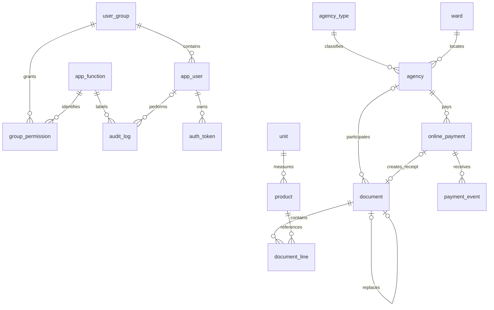

# Database DMS — mô hình đơn giản hóa (revision 0011)

## 1. Trạng thái và tài liệu

Ngày **14/11/2026** người dùng chốt đơn giản hóa nghiệp vụ (xem
[business_decision_making.md](business_decision_making.md) mục đầu và
[handoff](../../tmp/HANDOFF-don-gian-hoa-backend-frontend.md)). Schema hiện hành là
[0011_simplified_schema.sql](../../backend/alembic/sql/0011_simplified_schema.sql):
**16 bảng** trong schema `dms`, 3 loại chứng từ, 3 trạng thái, số dư hiện tại là hai
cột `agency.debt` và `product.stock`. Kế hoạch và bằng chứng kiểm tra:
[simplification PLAN](../backend-design/plan/simplification/PLAN.md) và
[VERIFICATION](../backend-design/plan/simplification/VERIFICATION.md).

| File | Mục đích |
| --- | --- |
| [business_decision_making.md](business_decision_making.md) | Quyết định thiết kế; mục 14/11/2026 ở đầu, lịch sử interview giữ nguyên bên dưới |
| [DMS.sql](DMS.sql) | Entry point psql: chạy snapshot `0011` (dựng lại toàn bộ schema `dms`) |
| [DMS.dbml](DMS.dbml) | Bản DBML 16 bảng: cột, khóa/quan hệ, CHECK, index và ghi chú trigger |
| [seed.example.sql](seed.example.sql) | Ví dụ tối thiểu 3 đơn vị, 3 mặt hàng cho schema trống; seed thật ở backend |
| [hcmc_wards_2025.json](hcmc_wards_2025.json) | Nguồn 168 phường/xã/đặc khu TP.HCM 2025 (mã GSO), đã nạp sẵn trong `0010`/`0011` |
| [search-indexes.sql](search-indexes.sql) | Ghi chú: index pg_trgm đã nằm trong `0011`, không cần chạy riêng |
| [verify.sql](verify.sql) | Chạy bộ regression SQL trên schema `0011`, fixture luôn rollback |
| [archive/DMS.legacy.sql](archive/DMS.legacy.sql) | Schema đầu vào gốc để đối chiếu; không dùng triển khai |
| [DMS_exploration.md](../BA/DMS_exploration.md) | BA đầu vào |

Phạm vi: một doanh nghiệp, một kho; không nhà cung cấp/công nợ nhà cung cấp, đa kho,
đa tiền tệ hay sổ cái kế toán. Không còn sổ kho/sổ phải thu/dư có dạng ledger.

Để xem trên dbdiagram.io, tạo diagram mới và dán `DMS.dbml`. Domain, generated column,
partial index, DEFERRABLE và trigger chỉ có ghi chú; triển khai bằng Alembic.

## 2. Migration 0011

- `0011` chạy `DROP SCHEMA IF EXISTS dms CASCADE` rồi dựng lại toàn bộ: domain, 16 bảng,
  index, hàm, trigger, 4 nhóm, 22 chức năng, phân quyền mặc định, 2 loại đại lý, quy định
  singleton và danh mục 168 phường/xã chép nguyên từ `0010`; cuối cùng `REVOKE ... FROM PUBLIC`.
- Từ DB trống (`0001 → 0011`) hay từ production `0010 → 0011` đều ra cùng một schema.
  **Dữ liệu không được chuyển**: sau `0011` phải chạy seed v2 (mục 6).
- **Không hỗ trợ downgrade**; `downgrade()` báo lỗi. Rollback là Neon branch backup tạo
  trước khi migrate (tên branch ghi trong VERIFICATION).
- Các snapshot `0001–0010` giữ nguyên, không sửa (quy ước snapshot bất biến).

## 3. Mười sáu bảng



| Nhóm | Bảng | Dữ liệu chính |
| --- | --- | --- |
| RBAC | `user_group` | 4 nhóm: Quản lý, Kinh doanh, Kho, Kế toán |
| RBAC | `app_function` | 22 chức năng (mục 4) |
| RBAC | `app_user` | Email duy nhất không phân biệt hoa/thường, Argon2id hash, nhóm, ACTIVE/LOCKED, authVersion |
| RBAC | `group_permission` | UNIQUE(groupId, functionId), isAllowed |
| Auth | `auth_token` | Digest SHA-256 refresh/reset, hết hạn/thu hồi, authVersion, sessionId |
| Quy định | `business_rule` | Singleton: `maxAgenciesPerWard` (mặc định 4), `sellingPriceRate` (1.02) |
| Danh mục | `ward` | 168 phường/xã/đặc khu TP.HCM 2025, chỉ đọc |
| Danh mục | `agency_type` | Mã/tên, `maxDebt` (Loại 1: 50.000.000đ, Loại 2: 20.000.000đ), trạng thái |
| Danh mục | `unit` | Mã/tên, `allowsFraction`, trạng thái |
| Đại lý | `agency` | Hồ sơ, loại/phường, ngày tiếp nhận, **`debt`**, ACTIVE/TERMINATED + lý do |
| Hàng | `product` | Tên, đơn vị, **`stock`**, **`lastPurchasePrice`**, trạng thái (bỏ `lowStockThreshold`) |
| Chứng từ | `document` | kind, mã sinh, đại lý, receiptType, businessDate, status, totalAmount, tỷ lệ chốt, `replacesDocumentId`, người/giờ lập-ghi sổ-hủy, lý do hủy |
| Chứng từ | `document_line` | Gắn thẳng vào `document`; mặt hàng/đơn vị + tên snapshot, SL, đơn giá, `lineAmount` generated |
| Online | `online_payment` | Giao dịch VNPAY: đại lý, merchantReference, idempotencyKey, mã giao dịch nhà cung cấp, số tiền, PENDING/SUCCESS/FAILED/EXPIRED, phiếu thu |
| Online | `payment_event` | Callback đã xác minh, append-only, UNIQUE(paymentId, eventKey) |
| Audit | `audit_log` | Tác nhân, chức năng, thao tác, trước/sau, requestId; append-only |

**Đã bỏ** (so với 0001–0010): `upfront_confirmation`, `credit_lot`, `credit_entry`,
`refund_reservation`, `refund_attempt`, `stock_count`, `stock_count_line`, `posting_batch`,
`receivable_entry`, `agency_balance`, `inventory_entry`, `inventory_balance`,
`document_revision`, `api_idempotency` (bảng command 0004). VNPAY tự chống trùng bằng
`online_payment.idempotencyKey` và `UNIQUE(provider, providerTransactionId)`.

### 3.1 Chứng từ

| kind | Mã | Đại lý | Dòng hàng | Ảnh hưởng khi POSTED |
| --- | --- | --- | --- | --- |
| `STOCK_RECEIPT` | `PN-<id>` | không | có (SL, đơn giá nhập) | `product.stock += SL`; cập nhật `lastPurchasePrice` |
| `STOCK_ISSUE` | `PX-<id>` | có | có (đơn giá xuất chốt khi ghi sổ) | `product.stock −= SL`; `agency.debt += tổng` |
| `PAYMENT_RECEIPT` | `PT-<id>` | có | không (chỉ số tiền) | `agency.debt −= số tiền` |

- `receiptType`: `CASH | BANK_TRANSFER | ONLINE`; `ONLINE` chỉ do IPN VNPAY tạo.
- Trạng thái `DRAFT → POSTED → CANCELLED`. Nháp sửa/xóa tự do (không cần lý do). Đã ghi sổ
  thì nội dung bất biến, chỉ được **hủy** (bắt buộc lý do, đảo đúng ảnh hưởng).
- **Sửa có lý do** = hủy phiếu cũ + tạo phiếu mới `POSTED` có `replacesDocumentId` trỏ về phiếu
  cũ, trong một transaction; phiếu mới vi phạm quy định thì rollback, phiếu cũ còn `POSTED`.
- Chỉ hủy/sửa chứng từ có ngày trong **tháng hiện tại** (`PERIOD_CLOSED`); ngày chứng từ không
  được sau hôm nay.

### 3.2 Quy định và nơi thực thi

| Mã | Quy định | Lỗi API | Database |
| --- | --- | --- | --- |
| QĐ1 | Đại lý ACTIVE mỗi phường ≤ `maxAgenciesPerWard` | `WARD_CAPACITY_EXCEEDED` | `guard_agency` (`ck_agency_ward_capacity`) |
| QĐ2 | Đơn giá xuất = round(`lastPurchasePrice` × `sellingPriceRate`); hàng chưa nhập không xuất được | `PRODUCT_NOT_PRICED` | service; `ck_document_rate_shape` |
| QĐ3 | Nợ sau ghi sổ phiếu xuất ≤ `maxDebt` | `DEBT_LIMIT_EXCEEDED` | `guard_agency` (`ck_agency_debt_limit`) khi `stock.issue.post` |
| QĐ4 | Phiếu thu thủ công 0 < số tiền ≤ nợ hiện tại | `PAYMENT_EXCEEDS_DEBT` | service; `guard_payment` (`ck_online_payment_debt`) cho VNPAY |
| QĐ5 | SL xuất ≤ tồn; hủy phiếu nhập không làm tồn âm | `INSUFFICIENT_STOCK` | `ck_product_stock_nonnegative` |
| QĐ6 | Đại lý TERMINATED, hàng/đơn vị INACTIVE không dùng cho chứng từ mới | mã hiện có | service; `lock_line_policy` |
| QĐ7 | Hủy phiếu thu có thể đẩy nợ vượt hạn mức: cho phép, có audit | — | — |
| QĐ8 | Chỉ hủy/sửa chứng từ trong tháng hiện tại; hủy/sửa bắt buộc lý do | `PERIOD_CLOSED`, `REASON_REQUIRED` | `ck_document_cancel_shape` (lý do khác rỗng) |
| — | Không chấm dứt đại lý còn nợ | `AGENCY_HAS_DEBT` (409) | service |

### 3.3 Số dư và VNPAY

- `agency.debt` = Σ phiếu xuất POSTED − Σ phiếu thu POSTED; `product.stock` = Σ nhập − Σ xuất.
  Hai cột (và `lastPurchasePrice`) chỉ đổi khi `dms.posting_context()` đúng, tức
  `dms.function_code` là một trong `stock.receipt.post`, `stock.issue.post`, `cash.receipt.post`,
  `documents.cancel`, `documents.correct`, `payments.online`. API danh mục không sửa được.
- Ghi sổ/hủy khóa `agency` rồi các `product` theo id tăng dần (`FOR UPDATE`) để tránh deadlock.
- VNPAY sandbox: tạo giao dịch với số tiền ≤ nợ; IPN thành công tạo phiếu thu `ONLINE` `POSTED`
  (`postedBy` NULL = hệ thống). Nếu nợ đã giảm vì phiếu khác, tiền vẫn được ghi nhận và **nợ có
  thể âm** (trả trước) — ngoại lệ duy nhất của QĐ4. Không còn hoàn tiền.

### 3.4 Trigger, guard và đồng hồ nghiệp vụ

| Hàm/trigger | Vai trò |
| --- | --- |
| `app_now()`, `business_today()` | Thời điểm = `dms.clock` nếu được đặt (chỉ seed), ngược lại `clock_timestamp()`; ngày theo `Asia/Ho_Chi_Minh` |
| `stamp_row` (`z_stamp`, mọi bảng) | Đặt `createdAt`/`updatedAt` theo `app_now()` |
| `audit_change` (11 bảng) | Ghi `audit_log` trước/sau theo `dms.actor_id`, `dms.request_id`, `dms.function_code`; bỏ `passwordHash`/`tokenDigest` |
| `deny_change` | `payment_event`, `audit_log` append-only |
| `guard_auth_version`, `guard_auth_token` | Tăng authVersion khi đổi mật khẩu/nhóm/trạng thái; token bất biến, thu hồi một chiều |
| `guard_agency`, `guard_agency_history_date` | QĐ1, QĐ3, debt bảo vệ, TERMINATED không mở lại, ngày tiếp nhận không sau lịch sử |
| `guard_rules` | Không xóa quy định; không giảm giới hạn phường/hạn mức xuống dưới hiện trạng |
| `guard_product`, `guard_recorded_unit_policy`, `lock_line_policy` | Stock/giá bảo vệ; đơn vị và chính sách số lẻ bất biến sau khi đã dùng |
| `guard_eligible_owner_deletion` | Chỉ xóa đại lý/mặt hàng chưa có lịch sử và số dư 0 |
| `guard_document`, `guard_line` | Máy trạng thái chứng từ, khớp tổng dòng, phiếu thu không dòng, chỉ dòng của nháp được đổi, phiếu thay thế cùng loại/đại lý |
| `guard_payment`, `check_online_payment` (deferred) | QĐ4 cho VNPAY; SUCCESS cần event đã xác minh và đúng một phiếu thu ONLINE khớp số tiền |

## 4. Chức năng phân quyền (22)

`users.manage`, `groups.manage`, `permissions.manage`, `rules.manage`, `agency_type.manage`,
`unit.manage`, `product.manage`, `agency.read`, `agency.manage`, `stock.receipt.prepare`,
`stock.receipt.post`, `stock.issue.prepare`, `stock.issue.post`, `cash.receipt.prepare`,
`cash.receipt.post`, `documents.correct`, `documents.cancel`, `sales.read`, `debt.read`,
`reports.read`, `audit.read`, `payments.online` ("Thanh toán trực tuyến").

Mặc định: Quản lý có mọi quyền; Kinh doanh `agency.read/manage`, `stock.issue.prepare`,
`sales.read`, `debt.read`; Kho `agency.read`, `unit.manage`, `product.manage`, lập + ghi sổ
phiếu nhập, ghi sổ phiếu xuất; Kế toán `agency.read`, `debt.read`, `sales.read`, `reports.read`,
lập + ghi sổ phiếu thu, `payments.online`. Đã bỏ: `district.manage`, `inventory.read`,
`cash.upfront.verify`, `stock.count`, `stock.adjustment.*`, `returns.*`, `cash.refund.*`,
`credit.apply`.

## 5. Quy ước dữ liệu

- PK danh mục nhỏ: INTEGER; tài khoản/đại lý/hàng/chứng từ: BIGINT identity. `DL-<id>`,
  `MH-<id>`, `PN-/PX-/PT-<id>` là cột generated, không nhập tay, không tái sử dụng.
- Mọi bảng có `"createdAt"`/`"updatedAt"` TIMESTAMPTZ NOT NULL (32 cột timestamp).
- Tên bảng snake_case; cột nhiều từ camelCase có quote.
- Domain: `money_vnd` (VNĐ nguyên, |x| < 10^18), `quantity_value` (≤ 3 số lẻ, |x| < 10^15),
  `price_rate` (0 < x < 1000, ≤ 6 số lẻ); NUMERIC không typmod + CHECK để từ chối thay vì làm tròn.

```text
giá xuất = round(giá nhập gần nhất × tỷ lệ, 0)   (chốt vào dòng khi ghi sổ)
thành tiền dòng = round(số lượng × đơn giá, 0)
tổng phiếu = Σ thành tiền dòng
```

### Báo cáo (truy vấn trực tiếp `document`/`document_line` POSTED)

| Báo cáo | Công thức |
| --- | --- |
| Doanh số tháng (BM5.1) | Theo đại lý: số phiếu xuất, tổng trị giá, tỷ lệ % trên tổng tháng |
| Công nợ tháng (BM5.2) | Nợ đầu = Σ xuất − Σ thu trước ngày 1; phát sinh = Σ xuất trong tháng; đã trả = Σ thu trong tháng; nợ cuối = đầu + phát sinh − trả. Nợ cuối tháng hiện tại = `agency.debt` |
| Tồn kho | Tồn đầu, nhập, xuất, tồn cuối theo mặt hàng; tồn cuối kỳ hiện tại = `product.stock` |
| Thu tiền | Theo `receiptType` và ngày |

Dùng khoảng nửa mở `[đầu tháng, đầu tháng sau)` để giữ index range.

## 6. Seed v2

[`backend/app/db/seed.py`](../../backend/app/db/seed.py) và
[`seed_data.py`](../../backend/app/db/seed_data.py):

- Một transaction dưới advisory lock; yêu cầu DB trống sau `0011`, chạy lại thì chỉ verify.
- Mọi chứng từ đi qua `DocumentService` (cùng quy định, số dư và audit như API); không chèn
  thẳng `debt`/`stock`. Mỗi thao tác đặt `dms.clock` để `createdAt/postedAt/cancelledAt` và audit
  mang đúng giờ nghiệp vụ (giờ hành chính, không ngày lễ 1–2/9).
- Lịch sử từ **01/06/2026 đến ngày làm việc trước ngày seed**; `random.Random(20261114)` cố định.
- Dữ liệu trông như thật, không chứa "mẫu/demo/test/thử"…: 11 tài khoản `@agentra.vn`
  (4 thành viên nhóm giữ 4 vai trò, 1 tài khoản LOCKED), 8 đơn vị tính, ≥ 24 mặt hàng có nhãn
  hiệu thật (1–2 ngừng kinh doanh, 1 mặt hàng chưa nhập lần nào), ≥ 30 đại lý hư cấu ở khoảng
  20 phường (có phường đủ 4/4, cặp trùng tên khác phường, 2 TERMINATED, đại lý mới chưa giao
  dịch, nợ sát hạn mức, nợ 0, 1 nợ âm do VNPAY về muộn), phiếu nhập/xuất/thu có hủy và sửa
  có lý do, nháp cả 3 loại, 15–25 giao dịch VNPAY SUCCESS/FAILED/EXPIRED (không PENDING).
- Bảng tài khoản, mật khẩu và số lượng thật từng bảng nằm ở [README root](../../README.md);
  tài liệu thiết kế không ghi mật khẩu.

## 7. Chạy và kiểm chứng

**Triển khai bằng Alembic**, từ `backend/`:

```sh
uv sync --frozen
uv run alembic upgrade head      # 0011 xóa và dựng lại schema dms — backup trước!
uv run python -m app.db.seed
uv run python -m app.db.verify --seeded --regression
```

- `verify` kiểm tra 16 bảng, timestamp, `debt`/`stock`/`lastPurchasePrice`/tổng phiếu khớp
  chứng từ POSTED, chuỗi thay thế trỏ tới phiếu CANCELLED, phiếu thu ONLINE khớp giao dịch,
  sức chứa phường, 168 phường, 22 chức năng và audit không lộ hash.
- `--seeded` thêm: mật khẩu từng tài khoản khớp hash Argon2id, khối lượng/tình huống seed,
  replay theo thời gian (tồn không âm, QĐ2/QĐ3 tại thời điểm ghi sổ), nợ cuối báo cáo tháng
  hiện tại = `agency.debt`, quét từ cấm trên mọi cột text, giờ hành chính, số điện thoại/địa chỉ.
- `--regression` chạy [`regression.sql`](../../backend/app/db/sql/regression.sql)
  (**83 kiểm tra** assert/expected rejection) trên một schema cô lập dựng từ snapshot `0011`
  (mọi token `dms` được đổi tên) và luôn rollback; cần quyền tạo schema.

Kết quả chạy thật (local, Neon branch tạm, production) ghi ở
[simplification VERIFICATION](../backend-design/plan/simplification/VERIFICATION.md).

**psql độc lập**, từ `openwiki/database-design/`, với connection qua biến PG*:

```sh
psql -v ON_ERROR_STOP=1 -f DMS.sql            # dựng schema dms từ 0011 (XÓA schema dms cũ)
psql -v ON_ERROR_STOP=1 -f seed.example.sql   # tùy chọn, schema trống
psql -v ON_ERROR_STOP=1 -f verify.sql         # regression trên schema 0011; luôn ROLLBACK
```

`DMS.sql` không ghi Alembic version; trên database do backend quản lý luôn dùng Alembic.
Không chạy `DMS.sql` lên database có dữ liệu cần giữ.

## 8. Lịch sử

- `0001`–`0009` (2026-10): mô hình 29 bảng + bảng command — chứng từ có phiên bản, ledger kho/
  phải thu/dư có, FIFO, trả ngay, trả hàng, bù trừ, hoàn tiền, kiểm kê, điều chỉnh kho.
- `0010`: thay `district` bằng danh mục 168 phường/xã TP.HCM 2025.
- `0011` (14/11/2026): đơn giản hóa như trên; production được xóa và seed lại theo quyết định
  của người dùng.

Mô tả chi tiết thiết kế 29 bảng cũ (transaction FIFO, trả hàng, refund, kiểm kê, 54 regression
cũ) còn trong lịch sử git của file này và trong các snapshot `backend/alembic/sql/0001–0010`;
không còn là thiết kế hiện hành.
